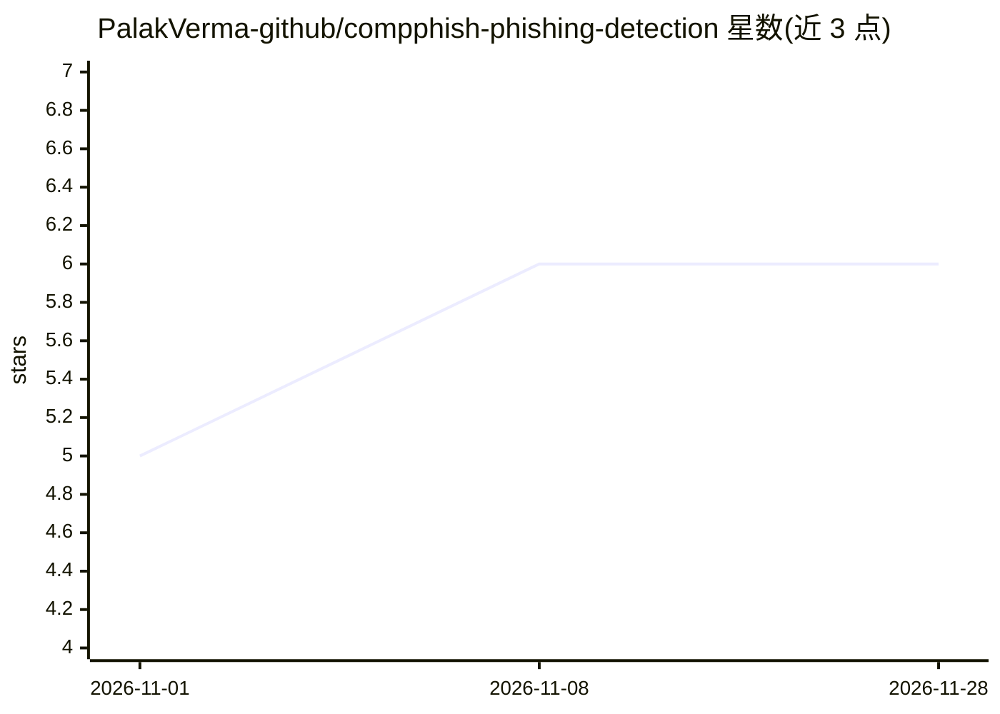

# PalakVerma-github/compphish-phishing-detection

⭐ 6 · Jupyter Notebook · 推送 2026-10-31 · [GitHub](https://github.com/PalakVerma-github/compphish-phishing-detection) · 个人维护

**机器学习钓鱼网站检测研究：比较 URL/HTML/组合特征**

基于 CompPhish Version 3 数据集（15,358 样本、70 特征）的监督学习研究项目，用 scikit-learn 训练 5 个分类器（逻辑回归、决策树、KNN、线性 SVM、随机森林），比较 URL 特征、HTML 特征与组合特征的检测效果，并做主机名分离评估、置换特征重要性与假阴性分析。面向科研/数据分析用途，以 Jupyter notebook 形式交付，数据文件需从 Mendeley 手动下载后放入 data 目录，通过 venv + pip 安装依赖运行。

## 筛选速览

| 维度 | 判定 | 备注 |
|---|---|---|
| AI 角色 | `ai-native` | 本体是模型或模型工具 |
| 许可风险 | `none` | — |
| 部署形态 | `desktop` | 安装包/桌面程序 |
| 模型依赖 | — | README 未给出锁定关系 |
| 硬件要求 | — | 无带数字的原话,不猜 |
| 安装摩擦 | `low` | 无编译、无系统依赖或容器化 |
| 成熟度 | — | 结构信号不足 |

## 能力要点

- 对比 44 个 URL 特征、23 个 HTML 特征与 67 个组合特征三组方案
- 5 个分类器统一 80/20 分层划分并报告精确率/召回率/F1/ROC-AUC/Log Loss
- 含主机名分离的分组评估与重复 URL 数据审计
- 提供相关性热图、ROC 曲线、混淆矩阵等图表

## 适用场景

- 复现基于 CompPhish 数据集的钓鱼检测实验
- 研究 URL 与 HTML 特征对钓鱼分类的贡献差异
- 学习分类模型评估与特征重要性分析流程

## 场景标签

`科研工具` `网络安全` · 领域:学习与行业

## 证据(README 行号)

> L3: A supervised machine learning project that compares URL-derived, HTML-derived, and combined features for detecting p
> L44: The main experiment uses an 80/20 stratified train/test split with `random_state=42`. All five classifiers use the 
> L197: 1. Download these Version 3 files from the CompPhish Mendeley record:

## 星数曲线

2026-11-01 5 → 2026-11-28 6（+1）

---
*卡片 v1 · prompt 1.4 · 生成 2026-11-20 · 置信度 high · 依据 README sha `ab859a23754e` · [字段定义](../../DATASET.md)*
