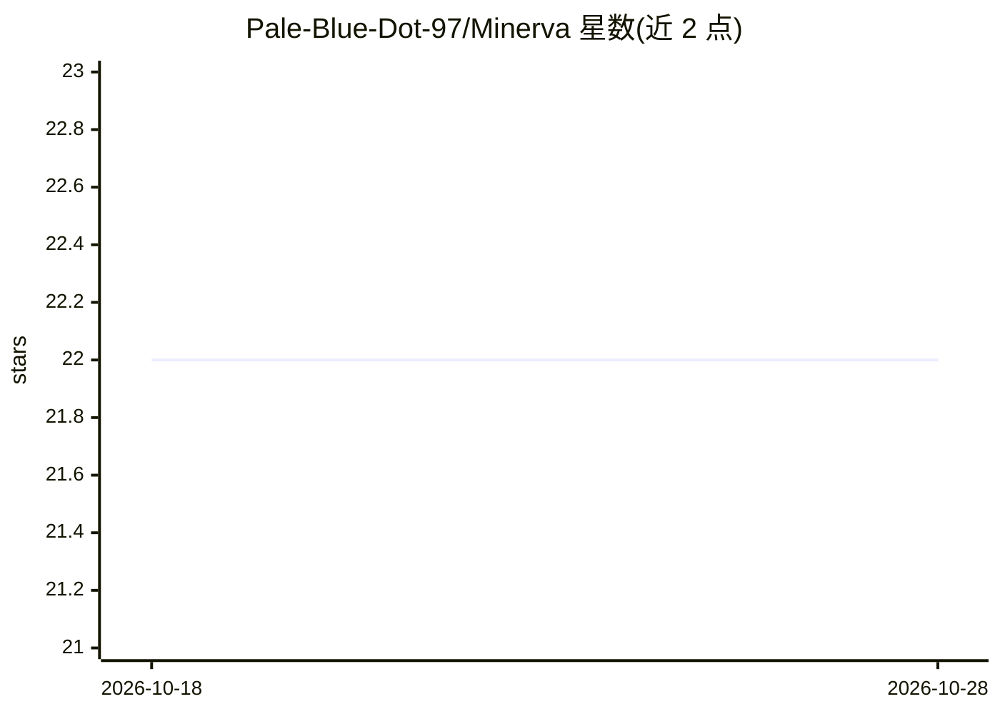

# Pale-Blue-Dot-97/Minerva

⭐ 22 · Python · MIT · 推送 2026-10-26 · [GitHub](https://github.com/Pale-Blue-Dot-97/Minerva) · 个人维护

**辅助构建、训练与测试多光谱地理空间神经网络模型的 Python 包**

Minerva 是面向多光谱地理空间遥感数据的神经网络模型工具包：提供 models（模型定义）、loaders（数据预处理/加载/解析）与 Trainer（统管模型拟合与测试）三类核心模块，覆盖土地覆盖分类数据的训练前后处理。设计上配合 torchgeo 数据集使用，torchvision 数据集支持在计划中；要求 Python 3.10–3.12，推荐 Linux 安装（torchgeo 的 C 库编译），也经 MacOS/Windows 测试。含 hydra 配置示例、数据集 manifest 脚本。由南安普顿大学博士项目创建，MIT 许可，当前处于 beta 阶段。

## 筛选速览

| 维度 | 判定 | 备注 |
|---|---|---|
| AI 角色 | `ai-native` | 本体是模型或模型工具 |
| 许可风险 | `permissive` | MIT |
| 部署形态 | `library` | 以包/库形式分发 |
| 模型依赖 | — | README 未给出锁定关系 |
| 硬件要求 | — | 无带数字的原话,不猜 |
| 安装摩擦 | `low` | 无编译、无系统依赖或容器化 |
| 成熟度 | `idea` | |

## 能力要点

- models/loaders/Trainer 三模块覆盖模型构建、数据预处理与拟合测试
- 支持 torchgeo 数据集，面向多光谱遥感与土地覆盖分类
- 提供 hydra 配置结构与数据集 manifest 构建脚本
- 支持 CNN/FCN/ResNet/MLP 等多种架构（据仓库主题标签）

## 适用场景

- 在多光谱遥感数据上训练土地覆盖分类模型
- 用 Trainer 统一管理模型拟合、测试与结果输出
- 复用预处理与数据加载模块搭建地学深度学习流水线

## 场景标签

`模型训练` · 领域:训练与推理

## 证据(README 行号)

> L31: Minerva is a package to aid in the building, fitting and testing of neural network models on multi-spectral geo-spa
> L61: The core functionality of `minerva` provides the modules to define `models` to fit and test, `loaders` to pre-proce

## 星数曲线

2026-10-18 22 → 2026-10-28 22（+0）

---
*卡片 v1 · prompt 1.4 · 生成 2026-10-27 · 置信度 mid · 依据 README sha `a945d0738b78` · [字段定义](../../DATASET.md)*
