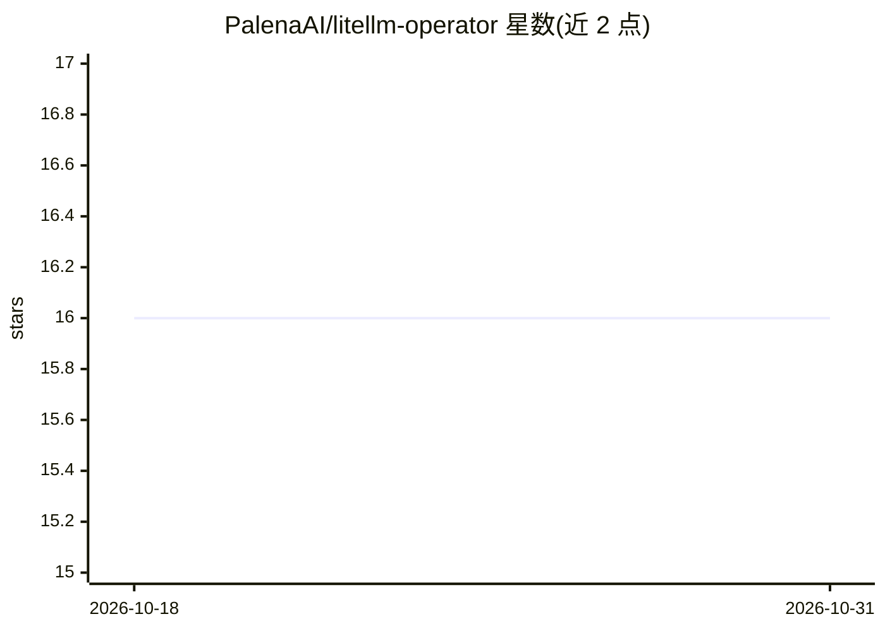

# PalenaAI/litellm-operator

⭐ 16 · Go · Apache-2.0 · 推送 2026-10-13 · [GitHub](https://github.com/PalenaAI/litellm-operator) · [官网](https://litellm-operator.palena.ai/) · 组织维护

**在 Kubernetes 上声明式部署与管理 LiteLLM AI 网关的 Operator**

基于 Operator SDK（Go）构建的 Kubernetes Operator，将 LiteLLM 网关的实例、组织、模型、团队、用户、虚拟密钥、预算、凭据与防护栏全部建模为 CRD，通过 LiteLLM REST API 持续调和，Git 为唯一事实源，Admin UI 漂移按 crd-wins/api-wins/manual 策略解决。支持 SSO/SCIM、OpenShift 非 root 模式、六后端响应缓存、外部密钥管理器集成与 OLM/Helm 双分发。面向在 K8s 上运维 LLM 网关的平台/DevOps 团队，需自备 PostgreSQL 与 K8s v1.28+ 集群；也可 attach 已有 LiteLLM 部署只管理实体资源。

## 筛选速览

| 维度 | 判定 | 备注 |
|---|---|---|
| AI 角色 | `ai-ecosystem` | LLM/agent 周边工具 |
| 许可风险 | `permissive` | Apache-2.0 |
| 部署形态 | `library` | 以包/库形式分发 |
| 模型依赖 | — | README 未给出锁定关系 |
| 硬件要求 | — | 无带数字的原话,不猜 |
| 安装摩擦 | `medium` | 含编译或系统依赖之一 |
| 成熟度 | — | 结构信号不足 |

## 能力要点

- 实例/模型/团队/用户/密钥等 11 类 CRD，双向配置同步与漂移解决策略
- 生成式虚拟密钥存于带 owner reference 的 K8s Secret，随 CRD 删除回收
- OpenShift 原生支持：Route、restricted SCC 兼容的非 root 镜像
- 外部密钥管理器（AWS/Azure/GCP/Vault）注入 provider API key，不进 etcd 与 operator 内存

## 适用场景

- 用 GitOps 方式管理 LiteLLM 网关的模型、团队与虚拟密钥
- 在 OpenShift 集群以声明式 CRD 部署 LLM 网关
- 对已有 Helm 部署的 LiteLLM 仅做实体级声明式管理
- 多租户组织/团队/用户层级配置预算与模型访问控制

## 场景标签

`模型网关` · 领域:Agent 开发

## 证据(README 行号)

> L5:  Production-grade Kubernetes operator for LiteLLM — declarative AI gateway deployments, bidirectional config sync, a
> L19: This operator dissolves that trade-off. Every resource — instances, organizations, models, teams, users, keys, cust
> L39: |**API-managed CRDs**|`LiteLLMOrganization`, `LiteLLMModel`, `LiteLLMTeam`, `LiteLLMUser`, `LiteLLMCustomer`, `Lite

## 星数曲线

2026-10-18 16 → 2026-10-31 16（+0）

---
*卡片 v1 · prompt 1.4 · 生成 2026-10-30 · 置信度 high · 依据 README sha `c156238a37b3` · [字段定义](../../DATASET.md)*
