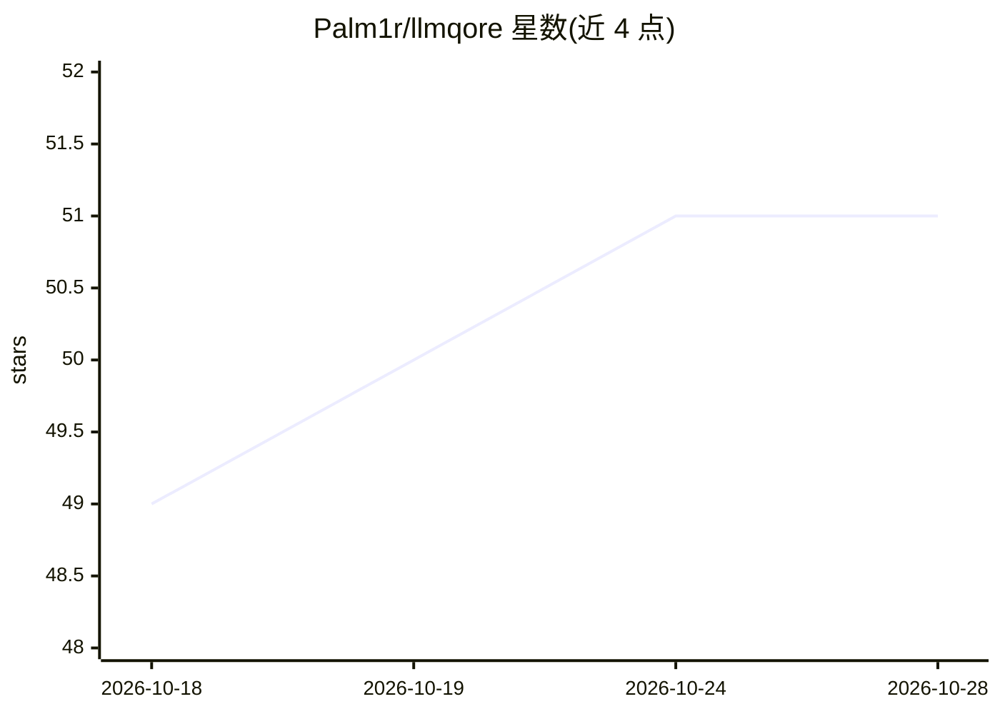

# Palm1r/llmqore

⭐ 51 · C++ · MIT · 推送 2026-10-12 · [GitHub](https://github.com/Palm1r/llmqore) · 个人维护

**Qt/C++ 库：统一接入云与本地 LLM、MCP 客户端/服务器与 ACP agent**

面向 Qt 开发者的 C++ 库，封装八种 LLM REST API（Claude、OpenAI Chat Completions 与 Responses、Google AI、Ollama、Mistral、llama.cpp、DeepSeek、Qwen），流式增量以 Qt 信号在同线程送达，异步结果走 QFuture。内置工具调用循环、跨提供者可移植的会话对象、MCP 客户端与服务器（stdio/Streamable HTTP/SSE）及 mcp-bridge 聚合 CLI，另可作为 ACP host 启动 Claude Code、Codex 等外部 agent。要求 C++20、Qt 5.15/6.5+、CMake 3.21+。

## 筛选速览

| 维度 | 判定 | 备注 |
|---|---|---|
| AI 角色 | `ai-ecosystem` | LLM/agent 周边工具 |
| 许可风险 | `permissive` | MIT |
| 部署形态 | `None` |  |
| 模型依赖 | local-ok | 支持本地模型 |
| 硬件要求 | — | 无带数字的原话,不猜 |
| 安装摩擦 | `medium` | 含编译或系统依赖之一 |
| 成熟度 | — | 结构信号不足 |

## 能力要点

- 八种 LLM 提供者统一 BaseClient 接口（含 Ollama/llama.cpp 本地模型）
- MCP 客户端/服务器实现 2025-11-25 spec，含 mcp-bridge 传输聚合 CLI
- 一次会话跨提供者翻译移植（messages/contents 等差异内部处理）
- ACP host 可驱动 Claude Code/Codex 外部 agent

## 适用场景

- Qt 桌面应用接入多家云端或本地 LLM 并做工具调用
- 在应用内同时作为 MCP 客户端消费工具、作为 MCP 服务器暴露工具
- 用 mcp-bridge 把多个上游 MCP 服务器聚合到一个端点后

## 场景标签

`模型网关` · 领域:Agent 开发

## 证据(README 行号)

> L6: Qt/C++ library for cloud and local LLM providers, MCP clients and servers, and ACP agents.
> L13: - **LLM REST API** — cloud and local: Claude, OpenAI Chat Completions, OpenAI Responses, Google AI, Mistral, DeepSe

## 星数曲线

2026-10-18 49 → 2026-10-28 51（+2）

---
*卡片 v1 · prompt 1.4 · 生成 2026-10-24 · 置信度 high · 依据 README sha `24185331eb44` · [字段定义](../../DATASET.md)*
