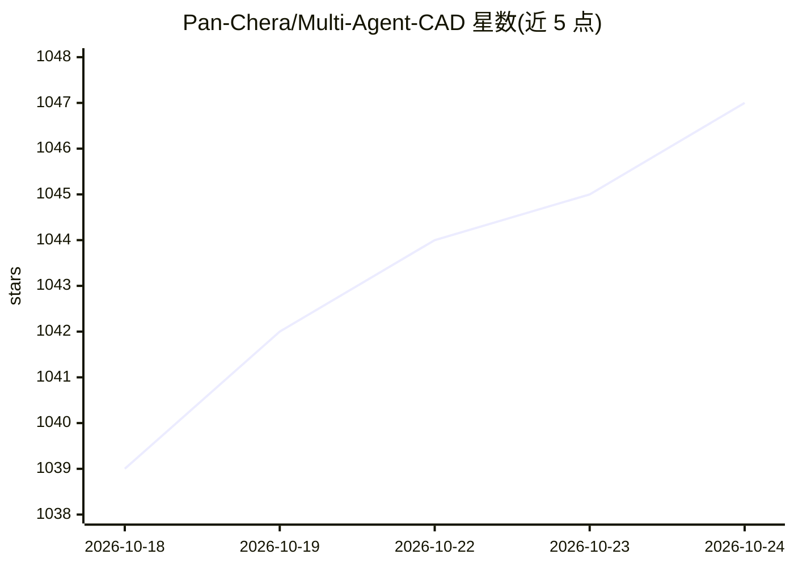

# Pan-Chera/Multi-Agent-CAD

⭐ 1,048 · Python · MIT · 推送 2026-10-17 · [GitHub](https://github.com/Pan-Chera/Multi-Agent-CAD) · 个人维护 · 中文 README

**多智能体框架：从自然语言生成可编辑 CAD 零件与装配体**

MAC（Multi-Agent CAD）将设计描述文本转化为可编辑的工程几何：生成单个可打印零件，或将机构分解为多个组件分别生成、装配、校验，并导出 STEP/STL/GLB 与 URDF。基于 build123d 构建，流程含规划、几何、编码、修复等阶段，可为各阶段配置不同的 OpenAI 兼容模型，并带视觉校验、独立 Judge 与浏览器 Web UI。装配生成为实验性技术预览，文档提示需在制造或仿真前校验几何；附十个提示、141 特征的单零件基准数据。

## 筛选速览

| 维度 | 判定 | 备注 |
|---|---|---|
| AI 角色 | `ai-native` | 本体是模型或模型工具 |
| 许可风险 | `permissive` | MIT |
| 部署形态 | `desktop` | 安装包/桌面程序 |
| 模型依赖 | locked-api |  |
| 硬件要求 | — | 无带数字的原话,不猜 |
| 安装摩擦 | `low` | 无编译、无系统依赖或容器化 |
| 成熟度 | `idea` | |

## 能力要点

- 自然语言生成单零件与多部件装配体，导出 STEP/STL/GLB/URDF
- 各阶段（规划/几何/编码/修复）可配置不同 OpenAI 兼容模型
- 自动执行与修复生成 CAD，含视觉与几何校验及独立 Judge
- 提供带 3D 预览的浏览器 Web UI（默认仅监听回环地址）

## 适用场景

- 用自然语言描述需求，生成可编辑的机械零件模型
- 生成多部件装配机构并导出 URDF 用于机器人仿真
- 制作可直接 3D 打印（含 print-in-place 机构）的模型

## 场景标签

`多智能体` `Agent 框架` · 领域:Agent 开发

## 证据(README 行号)

> L13: MAC turns an ordinary design brief into editable engineering geometry. It can
> L139: - **Natural-language input** — describe geometry, dimensions, interfaces, and
> L151: - **Model-flexible stages** — configure different OpenAI-compatible models for

## 星数曲线

2026-10-18 1,039 → 2026-10-24 1,047（+8）

---
*卡片 v1 · prompt 1.4 · 生成 2026-10-21 · 置信度 high · 依据 README sha `83b69d1298f7` · [字段定义](../../DATASET.md)*
