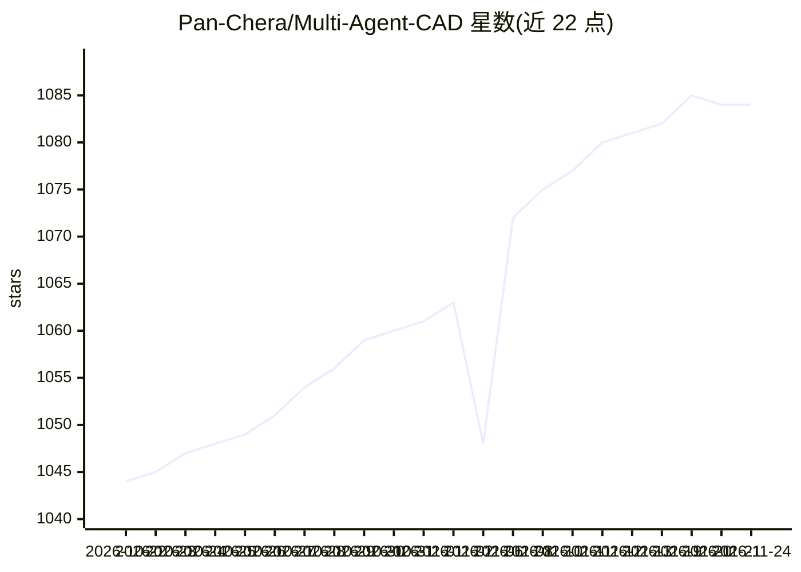

# Pan-Chera/Multi-Agent-CAD

⭐ 1,085 · Python · MIT · 推送 2026-11-04 · [GitHub](https://github.com/Pan-Chera/Multi-Agent-CAD) · 组织维护 · 中文 README

**面向工程师的自然语言文本生成可编辑 CAD 模型的多智能体框架**

MAC 以自然语言设计简报为输入，生成可编辑的工程几何：支持单一可打印零件生成，v2 新增视觉验证、独立 Judge 与实验性多零件装配生成，可将机构分解为组件、装配并导出 STEP/STL/GLB/URDF。流程为解耦的多智能体流水线（规划、几何、编码、修复各阶段可配置不同 OpenAI 兼容模型），带几何/视觉校验与有限反馈修复回路，并提供浏览器 Web UI（3D 预览、CSRF 防护）。来自清华大学 IEI 实验室，MIT 许可，Python 3.11+，基于 build123d。

## 筛选速览

| 维度 | 判定 | 备注 |
|---|---|---|
| AI 角色 | `ai-native` | 本体是模型或模型工具 |
| 许可风险 | `permissive` | MIT |
| 部署形态 | `desktop` | 安装包/桌面程序 |
| 模型依赖 | local-ok | 支持本地模型 |
| 硬件要求 | — | 无带数字的原话,不猜 |
| 安装摩擦 | `low` | 无编译、无系统依赖或容器化 |
| 成熟度 | — | 结构信号不足 |

## 能力要点

- 自然语言分解机构为组件并装配，导出 STEP/STL/GLB 与 URDF
- 结构化简报、几何规划、生成 Python、QA 报告与修复历史全程可审计
- 各阶段可配置不同 OpenAI 兼容模型（规划/几何/编码/修复）
- 带 3D 预览的浏览器 Web UI 与 CSRF 防护

## 适用场景

- 从文字描述直接生成可 3D 打印的机械零件
- 把机构拆解为组件并生成带关节接口的装配体
- 导出 URDF 用于机器人学与物理仿真
- 低成本复现/审计 text-to-CAD 基准测试结果

## 场景标签

`多智能体` `模型评测` `代码生成` · 领域:Agent 开发

## 证据(README 行号)

> L13: MAC turns an ordinary design brief into editable engineering geometry. It can
> L151: - **Model-flexible stages** — configure different OpenAI-compatible models for
> L164: git clone https://github.com/Pan-Chera/Multi-Agent-CAD.git

## 星数曲线

2026-10-22 1,044 → 2026-11-24 1,084（+40）

---
*卡片 v1 · prompt 1.4 · 生成 2026-11-24 · 置信度 high · 依据 README sha `105cae78a23e` · [字段定义](../../DATASET.md)*
