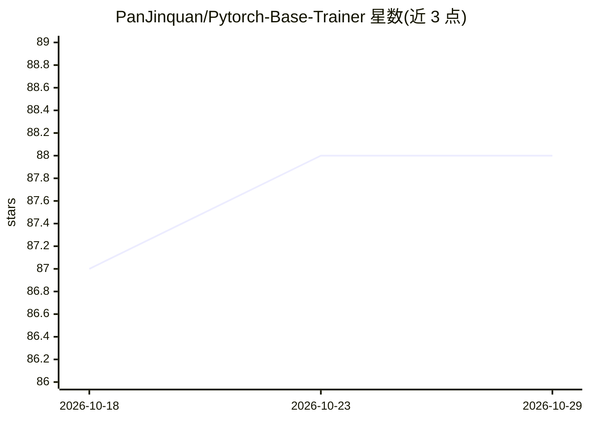

# PanJinquan/Pytorch-Base-Trainer

⭐ 88 · Python · MIT · 推送 2026-10-08 · [GitHub](https://github.com/PanJinquan/Pytorch-Base-Trainer) · 个人维护 · 中文 README

**基于 PyTorch 的轻量训练框架：多卡/分布式训练、回调、剪枝**

借鉴 Keras 设计的 PyTorch 基础训练库（basetrainer），面向需要快速搭建训练工程的深度学习开发者。提供 Engine/EngineTrainer 训练引擎与 Callback 回调机制（ModelCheckpoint、LogHistory、多种学习率调度等），支持 DP/DDP 多卡分布式训练、argparse 与 config.yaml 双配置方式，以及基于 NNI 的模型剪枝（L1/L2、FPGM、Slim）。作者基于其内部实现了分类、检测、分割、姿态检测四个通用库，但这些库受商业保护未开源。通过 pip 或源码安装。

## 筛选速览

| 维度 | 判定 | 备注 |
|---|---|---|
| AI 角色 | `ai-ecosystem` | LLM/agent 周边工具 |
| 许可风险 | `permissive` | MIT |
| 部署形态 | `library` | 以包/库形式分发 |
| 模型依赖 | — | README 未给出锁定关系 |
| 硬件要求 | — | 无带数字的原话,不猜 |
| 安装摩擦 | `low` | 无编译、无系统依赖或容器化 |
| 成熟度 | — | 结构信号不足 |

## 能力要点

- 支持 DP 多卡训练与 DDP 分布式训练
- EngineTrainer 基类 + 自定义 Callback 回调机制
- NNI 模型剪枝（L1/L2-Pruner、FPGM-Pruner、Slim-Pruner）
- argparse 命令行与 config.yaml 配置文件双参数方式

## 适用场景

- 快速搭建自己的 PyTorch 分类/检测等训练工程
- 在多卡或多机环境下进行分布式模型训练
- 训练中保存最优模型并使用 Tensorboard 可视化

## 场景标签

`模型训练` · 领域:训练与推理

## 证据(README 行号)

> L10: 考虑到深度学习训练过程都有一套约定成俗的流程，鄙人借鉴**Keras**开发了一套基础训练库： **Pytorch-Base-Trainer(PBT)**； 这是一个基于Pytorch开发的基础训练库，支持以下特征：
> L12: - [x] 支持多卡训练训练(DP模式)和分布式多卡训练(DDP模式)，参考build_model_parallel

## 星数曲线

2026-10-18 87 → 2026-10-29 88（+1）

---
*卡片 v1 · prompt 1.4 · 生成 2026-10-23 · 置信度 high · 依据 README sha `3ef6849500d5` · [字段定义](../../DATASET.md)*
