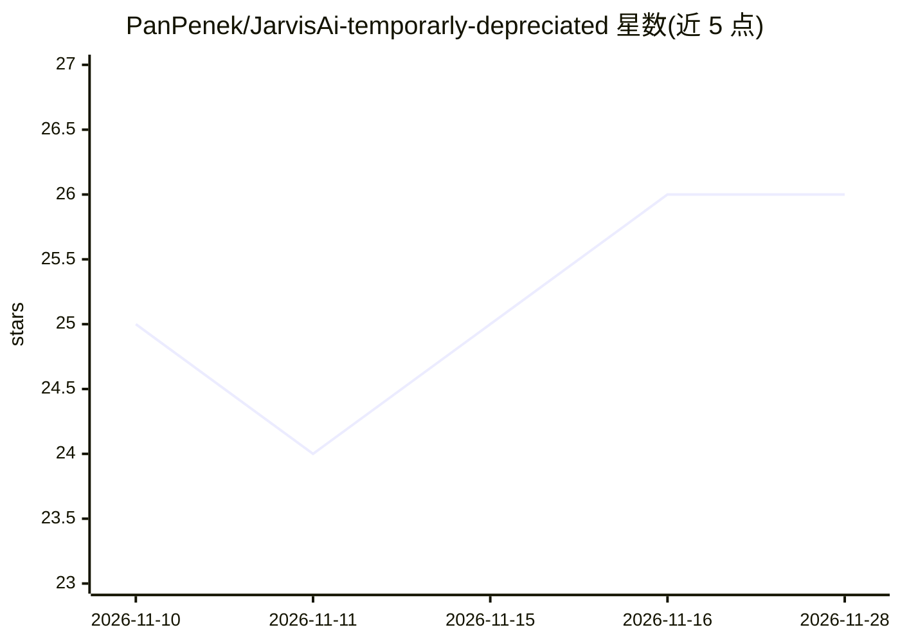

# PanPenek/JarvisAi-temporarly-depreciated

⭐ 26 · Python · 推送 2026-11-21 · [GitHub](https://github.com/PanPenek/JarvisAi-temporarly-depreciated) · 个人维护

**全本地离线 AI 语音助手，含唤醒词与屏幕视觉**

运行在 Windows 上的完全本地化语音助手：pyaudio 唤醒词（openWakeWord ONNX）、faster-whisper 语音转写、Ollama 本地 LLM 与 Kokoro-82M 语音合成组成流水线，默认无数据离开本机。内置 31 个工具覆盖桌面自动化、OCR 屏幕读取、应用控制、网络搜索与文件操作，支持单次请求最多 15 步的工具链式调用；记忆用 SQLite+ChromaDB，界面为 FastAPI+WebSocket 的 localhost 网页 UI。需 Python 3.11+ 与 Ollama，仅支持 Windows 10/11。

## 筛选速览

| 维度 | 判定 | 备注 |
|---|---|---|
| AI 角色 | `ai-native` | 本体是模型或模型工具 |
| 许可风险 | `none` | — |
| 部署形态 | `None` |  |
| 模型依赖 | local-ok | 支持本地模型 |
| 硬件要求 | — | 无带数字的原话,不猜 |
| 安装摩擦 | `medium` | 含编译或系统依赖之一 |
| 成熟度 | — | 结构信号不足 |

## 能力要点

- 31 个内置工具，单次请求最多 15 步工具链式调用
- 全组件本地运行：Whisper STT、Kokoro TTS、Ollama LLM
- OCR 屏幕视觉：读取屏幕文本并按坐标点击按钮
- SQLite+ChromaDB 跨会话持久记忆

## 适用场景

- 语音口令控制桌面应用与系统设置
- 让助手读取屏幕并代为点击操作
- 离线环境下运行不联网的个人助手

## 场景标签

`语音 Agent` `AI 助手` `GUI 自动化` · 领域:效率与自动化

## 证据(README 行号)

> L3: A fully local, agentic AI voice assistant with wake word detection, screen vision, desktop control, and an Iron Man-
> L82: **Pipeline:** Wake word → Record speech → Transcribe (Whisper) → LLM with tools → Speak response (Kokoro)
> L17: - **Multiple LLM providers** — Ollama (local), LM Studio, OpenAI, NVIDIA NIM, or any OpenAI-compatible API

## 星数曲线

2026-11-10 25 → 2026-11-28 26（+1）

---
*卡片 v1 · prompt 1.4 · 生成 2026-11-23 · 置信度 high · 依据 README sha `de35d0043417` · [字段定义](../../DATASET.md)*
