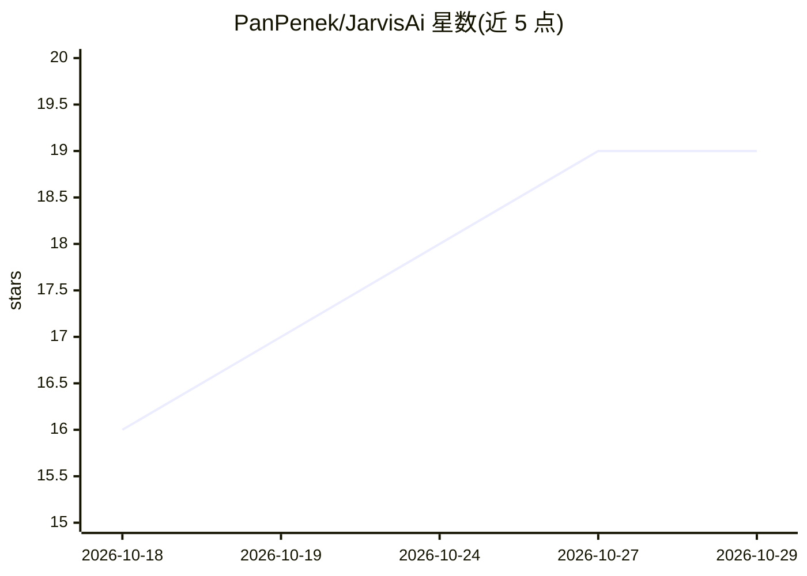

# PanPenek/JarvisAi

⭐ 19 · Python · 推送 2026-03-01 · [GitHub](https://github.com/PanPenek/JarvisAi) · 个人维护

**全离线的本地 AI 语音助手：唤醒词、屏幕视觉与 31 个桌面工具**

面向 Windows 用户的本地代理式语音助手：openWakeWord 唤醒、faster-whisper 语音识别、Kokoro-82M 语音合成、LLM 负责推理，全部组件本地运行。支持 OCR 屏幕阅读与点击等桌面自动化，内置 31 个工具，单次请求最多 15 步连续工具调用；SQLite+ChromaDB 提供跨会话记忆。LLM 可用 Ollama 本地模型或任意 OpenAI 兼容 API（LM Studio/vLLM/Groq 等）。通过 install.bat 一键安装、start.bat 启动，Web UI 位于 localhost:7860。

## 筛选速览

| 维度 | 判定 | 备注 |
|---|---|---|
| AI 角色 | `ai-native` | 本体是模型或模型工具 |
| 许可风险 | `none` | — |
| 部署形态 | `None` |  |
| 模型依赖 | local-ok | 支持本地模型 |
| 硬件要求 | — | 无带数字的原话,不猜 |
| 安装摩擦 | `medium` | 含编译或系统依赖之一 |
| 成熟度 | — | 结构信号不足 |

## 能力要点

- 唤醒词 'Hey Jarvis' 全语音交互，STT/TTS/LLM 全本地
- 31 个工具：桌面自动化、OCR 屏幕视觉、应用控制、文件与系统命令
- 代理式工具链，单请求最多 15 次连续工具调用
- SQLite + ChromaDB 跨会话持久记忆

## 适用场景

- 用语音指挥电脑完成点击、输入、开关应用等操作
- 让助手读取屏幕内容并按坐标操作界面元素
- 在无云端依赖的前提下获得带记忆的对话助手

## 场景标签

`语音 Agent` `GUI 自动化` · 领域:效率与自动化

## 证据(README 行号)

> L3: A fully local, agentic AI voice assistant with wake word detection, screen vision, desktop control, and an Iron Man-
> L82: **Pipeline:** Wake word → Record speech → Transcribe (Whisper) → LLM with tools → Speak response (Kokoro)

## 星数曲线

2026-10-18 16 → 2026-10-29 19（+3）

---
*卡片 v1 · prompt 1.4 · 生成 2026-10-29 · 置信度 high · 依据 README sha `c7a80a91ce9e` · [字段定义](../../DATASET.md)*
