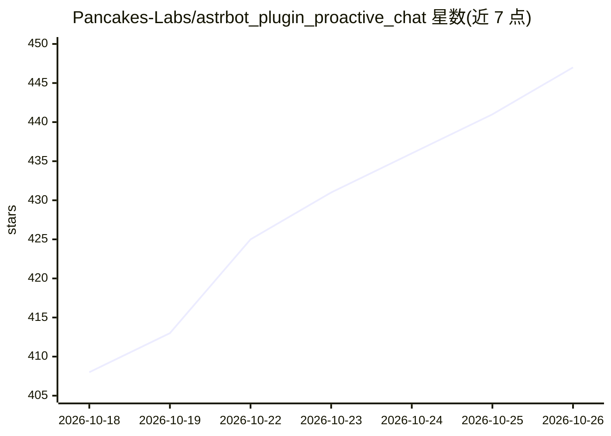

# Pancakes-Labs/astrbot_plugin_proactive_chat

⭐ 447 · Python · AGPL-3.0 · 推送 2026-10-18 · [GitHub](https://github.com/Pancakes-Labs/astrbot_plugin_proactive_chat) · 个人维护 · 中文 README

**AstrBot 主动消息插件：Bot 静默后主动发起拟人对话**

为聊天机器人框架 AstrBot 编写的 Python 插件（要求 AstrBot v4.24.0+、Python 3.10+），在私聊或群聊长时间无消息后按随机时间间隔主动发起对话。机制包括：基于用户沉默时间定时触发、上下文感知（LLM 对话历史/平台聊天流水/混合三种来源）、加载会话人格、未回复计数器驱动的动态情绪、任务持久化恢复、免打扰时段、TTS 集成与分段回复。附带独立 WebUI 提供运行状态、任务管理等五大视图。通过 AstrBot 插件市场或 Release zip 安装；README 声明代码主要由 AI 生成，需配合提示词才能获得理想效果。

## 筛选速览

| 维度 | 判定 | 备注 |
|---|---|---|
| AI 角色 | `ai-ecosystem` | LLM/agent 周边工具 |
| 许可风险 | `viral` | AGPL-3.0 |
| 部署形态 | `library` | 以包/库形式分发 |
| 模型依赖 | — | README 未给出锁定关系 |
| 硬件要求 | — | 无带数字的原话,不猜 |
| 安装摩擦 | `low` | 无编译、无系统依赖或容器化 |
| 成熟度 | `idea` | |

## 能力要点

- 基于沉默时间的随机间隔主动消息触发，多会话隔离与持久化恢复
- 三种上下文来源（对话历史/平台流水/混合）与人格加载
- 未回复计数器支持动态情绪设计，可设免打扰时段与未回复上限
- 插件自带 WebUI：运行状态、任务管理、配置管理等五大视图

## 适用场景

- 让我的聊天 Bot 在我沉默一段时间后主动来找我聊天
- 为不同私聊/群聊会话分别配置主动消息策略与人设
- 通过 WebUI 查看 Bot 主动消息的倒计时与任务状态

## 场景标签

`聊天机器人` · 领域:对话与助手

## 证据(README 行号)

> L23:  一个为 AstrBot 设计的、功能强大的主动消息插件。它能让你的 Bot 在特定的会话长时间没有新消息后，用一个随机的时间间隔，主动发起一次拥有上下文感知、符合人设且包含动态情绪的对话。
> L113: - **定时触发**: 基于用户沉默时间，在设定的随机时间范围内自动触发。
> L117: - **上下文感知**: 支持灵活选择上下文来源，回顾历史对话，并根据你设定的提示词，生成与之前话题相关的回复，而不是生硬的问候。

## 星数曲线

2026-10-18 408 → 2026-10-26 447（+39）

---
*卡片 v1 · prompt 1.4 · 生成 2026-10-22 · 置信度 mid · 依据 README sha `9777f0cec264` · [字段定义](../../DATASET.md)*
