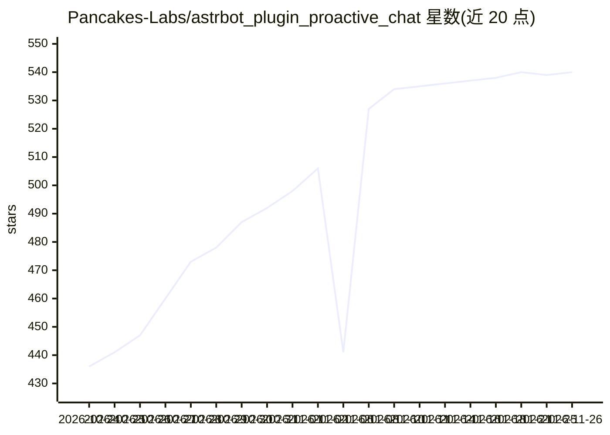

# Pancakes-Labs/astrbot_plugin_proactive_chat

⭐ 540 · Python · AGPL-3.0 · 推送 2026-11-25 · [GitHub](https://github.com/Pancakes-Labs/astrbot_plugin_proactive_chat) · 个人维护 · 中文 README

**AstrBot 主动消息插件：让 Bot 按沉默计时主动发起拟人对话**

面向 AstrBot 的主动消息插件：在私聊/群聊长时间无新消息后，按随机间隔触发 Bot 主动发消息。机制包括上下文注入（LLM 对话历史/平台聊天流水/混合）、人格加载、未回复计数驱动的动态情绪、任务持久化、免打扰时段、TTS 语音与分段模拟打字回复。通过发送模拟用户消息交由模型生成内容，效果依赖提示词质量。要求 Python 3.10+ 与 AstrBot v4.24.0+，提供独立 WebUI 管理任务、状态与配置。

## 筛选速览

| 维度 | 判定 | 备注 |
|---|---|---|
| AI 角色 | `ai-native` | 本体是模型或模型工具 |
| 许可风险 | `viral` | AGPL-3.0 |
| 部署形态 | `library` | 以包/库形式分发 |
| 模型依赖 | — | README 未给出锁定关系 |
| 硬件要求 | — | 无带数字的原话,不猜 |
| 安装摩擦 | `low` | 无编译、无系统依赖或容器化 |
| 成熟度 | — | 结构信号不足 |

## 能力要点

- 基于沉默时间与随机间隔的定时触发，支持多会话隔离与持久化恢复
- 上下文感知生成：可选对话历史/平台流水/混合三种来源
- 动态情绪（未回复计数器）与免打扰时段控制
- 独立 WebUI：任务管理、倒计时可视化、WebSocket 实时同步

## 适用场景

- 让陪伴型 Bot 在沉默一段时间后主动开口续聊
- 为多个群聊/私聊分别配置不同的主动消息策略与人设
- 需要免打扰时段和 TTS 语音推送的聊天机器人场景

## 场景标签

`聊天机器人` `语音合成` · 领域:对话与助手

## 证据(README 行号)

> L23:  一个为 AstrBot 设计的、功能强大的主动消息插件。它能让你的 Bot 在特定的会话长时间没有新消息后，用一个随机的时间间隔，主动发起一次拥有上下文感知、符合人设且包含动态情绪的对话。
> L97: > 这是因为几乎所有实现主动消息的插件，都是通过发出一条**模拟的用户消息**来实现的，因此需要配合高质量的提示词，才能避免模型的回复"出戏"。
> L118: - **上下文感知**: 支持灵活选择上下文来源，回顾历史对话，并根据你设定的提示词，生成与之前话题相关的回复，而不是生硬的问候。

## 星数曲线

2026-10-24 436 → 2026-11-26 540（+104）

---
*卡片 v1 · prompt 1.4 · 生成 2026-11-25 · 置信度 mid · 依据 README sha `dce3b57e8ee7` · [字段定义](../../DATASET.md)*
