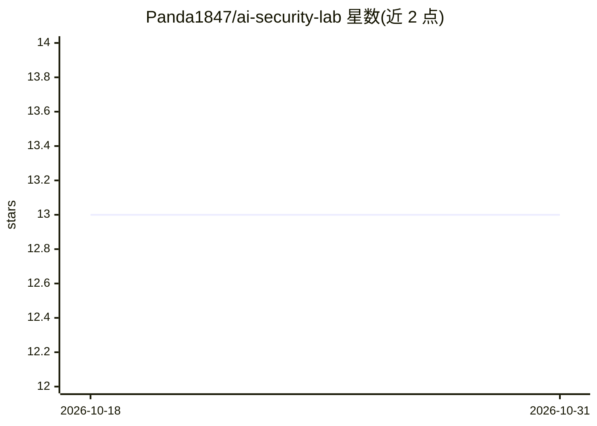

# Panda1847/ai-security-lab

⭐ 13 · MIT · 推送 2026-07-07 · [GitHub](https://github.com/Panda1847/ai-security-lab) · 个人维护

**面向安全研究者的 LLM 红队测试框架，含越狱与注入测试工具**

针对 LLM 与 AI 系统的安全测试与红队评估框架，面向安全研究者、红队成员与 AI 开发者。集成 Garak、PyRIT、Promptfoo 三类工具，并自带越狱测试器、提示注入扫描器、对抗提示生成器、偏见检测、数据提取测试等脚本；收录 50+ 种越狱技巧与 1000+ 条攻击提示库，支持 GPT-4、Claude、Gemini、LLaMA 等多模型（需配置 API key）。按侦察、扫描、越狱、对抗、报告五阶段组织测试流程，自动生成漏洞报告；附有授权使用与禁止使用的伦理条款。

## 筛选速览

| 维度 | 判定 | 备注 |
|---|---|---|
| AI 角色 | `ai-ecosystem` | LLM/agent 周边工具 |
| 许可风险 | `permissive` | MIT |
| 部署形态 | `None` |  |
| 模型依赖 | — | README 未给出锁定关系 |
| 硬件要求 | — | 无带数字的原话,不猜 |
| 安装摩擦 | `low` | 无编译、无系统依赖或容器化 |
| 成熟度 | — | 结构信号不足 |

## 能力要点

- 50+ 越狱技巧与 1000+ 条攻击提示库
- 集成 Garak / PyRIT / Promptfoo 三类评估工具
- 自定义脚本覆盖提示注入扫描、偏见检测、数据提取测试
- 五阶段测试方法论与自动化报告生成

## 适用场景

- 对自己的 LLM 部署做自动化漏洞扫描与评估
- 红队测试模型的越狱与提示注入抵抗力
- 检测模型输出中的歧视性偏见或训练数据泄漏

## 场景标签

`网络安全` `模型评测` · 领域:评测与运维

## 证据(README 行号)

> L16: AI Security Lab is a comprehensive framework for testing and evaluating the security of Large Language Models (LLMs
> L20: As AI systems become increasingly integrated into critical applications, understanding their vulnerabilities is ess
> L41: |**LLM Vulnerability Scanner**|Automated security assessment (Garak, PyRIT)|✅ Active|

## 星数曲线

2026-10-18 13 → 2026-10-31 13（+0）

---
*卡片 v1 · prompt 1.4 · 生成 2026-10-31 · 置信度 high · 依据 README sha `e86d1f07186e` · [字段定义](../../DATASET.md)*
