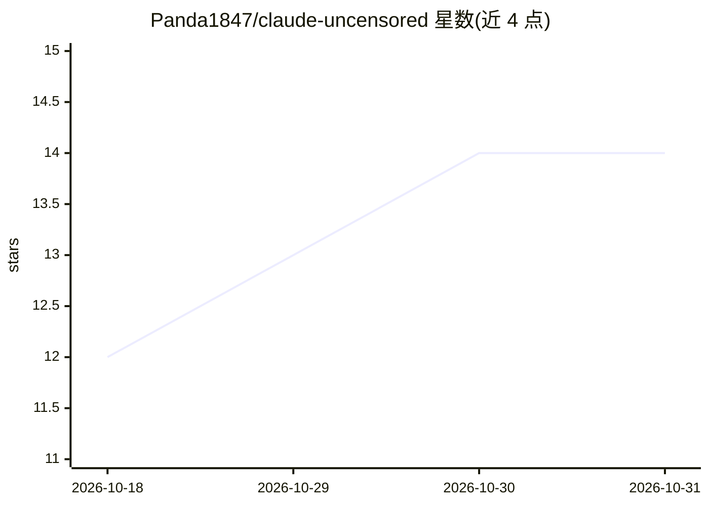

# Panda1847/claude-uncensored

⭐ 14 · MIT · 推送 2026-02-07 · [GitHub](https://github.com/Panda1847/claude-uncensored) · 个人维护

**名为 claude-uncensored 的项目，README 为模板内容，实际功能未说明**

仓库 README 仅包含通用模板文本：自述为“专业 Unknown 项目”，功能列表为“专业级实现、文档完善、易集成、积极维护”等模板化条目，未描述具体做什么。安装部分仅给出 git clone 命令与占位注释，使用部分为“参见文档”占位。MIT 许可，作者为个人（Michael Lastovich / Panda1847），含“仅供教育与授权测试用途”免责声明。主题标签含 ai、chatbot、claude-ai、llm、uncensored，但正文中无可验证的功能事实。

## 筛选速览

| 维度 | 判定 | 备注 |
|---|---|---|
| AI 角色 | `ai-native` | 本体是模型或模型工具 |
| 许可风险 | `permissive` | MIT |
| 部署形态 | `None` |  |
| 模型依赖 | — | README 未给出锁定关系 |
| 硬件要求 | — | 无带数字的原话,不猜 |
| 安装摩擦 | `low` | 无编译、无系统依赖或容器化 |
| 成熟度 | — | 结构信号不足 |

## 能力要点

- README 为模板生成内容，无具体功能描述
- 安装方式仅 git clone 源码，无依赖安装或运行命令
- MIT 许可，含教育/授权测试用途免责声明

## 适用场景

- 无法从 README 确定具体使用场景

## 场景标签

 · 领域:未知（README 未说明）

## 证据(README 行号)

> L12: A professional Unknown project for advanced use cases.
> L16: - Professional-grade implementation

## 星数曲线

2026-10-18 12 → 2026-10-31 14（+2）

---
*卡片 v1 · prompt 1.4 · 生成 2026-10-31 · 置信度 low · 依据 README sha `e0c78be2e73e` · [字段定义](../../DATASET.md)*
