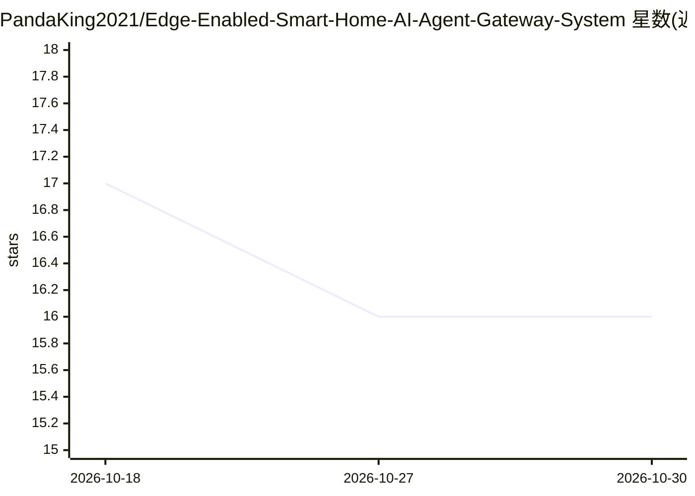

# PandaKing2021/Edge-Enabled-Smart-Home-AI-Agent-Gateway-System

⭐ 16 · Python · MIT · 推送 2026-04-19 · [GitHub](https://github.com/PandaKing2021/Edge-Enabled-Smart-Home-AI-Agent-Gateway-System) · 个人维护 · 中文 README

**边缘计算智能家居网关：对话式 AI Agent 编排控制设备**

基于家庭边缘网关的智能家居系统，包含 Python 网关服务器、MySQL 数据库服务、Android 控制应用与 ESP8266 设备固件（空调/窗帘/门禁单元）。核心 AI 能力是以 GLM-4.7-Flash（智谱 API）驱动的 Agent 模块，做意图识别、任务分解、设备能力检索与执行，并带三级意图缓存减少 LLM 调用；数据本地处理并支持阿里云 IoT 上传。去掉 AI 模块后网关与设备管理仍可运行。安装需克隆源码、pip 装依赖、配置 MySQL 并初始化表结构。

## 筛选速览

| 维度 | 判定 | 备注 |
|---|---|---|
| AI 角色 | `ai-enhanced` | 去掉 AI 部分产品仍成立 |
| 许可风险 | `permissive` | MIT |
| 部署形态 | `library` | 以包/库形式分发 |
| 模型依赖 | — | README 未给出锁定关系 |
| 硬件要求 | — | 无带数字的原话,不猜 |
| 安装摩擦 | `low` | 无编译、无系统依赖或容器化 |
| 成熟度 | — | 结构信号不足 |

## 能力要点

- AI Agent 模块：意图识别、任务规划、设备能力检索与任务执行
- 三级意图缓存，减少 40-70% 的 LLM API 调用
- ESP8266 空调/窗帘/门禁三类设备固件与设备模拟器
- Android 应用远程监控，支持阿里云 IoT 数据上传

## 适用场景

- 用自然语言对话让家里空调、窗帘、门禁协同工作
- 在家庭边缘网关上本地处理数据以降低上云与延迟
- 用设备模拟器搭建测试环境验证联动场景

## 场景标签

`Agent 框架` · 领域:Agent 开发

## 证据(README 行号)

> L11: **EdgeHomeAI** is a smart home gateway system based on edge computing, integrating AI Agent conversational task orc
> L26: - **AI Agent Task Orchestration**: Natural language understanding and task decomposition
> L168: │ │ └── ai_agent/ # AI Agent module

## 星数曲线

2026-10-18 17 → 2026-10-30 16（-1）

---
*卡片 v1 · prompt 1.4 · 生成 2026-10-30 · 置信度 low · 依据 README sha `a8003907b18a` · [字段定义](../../DATASET.md)*
