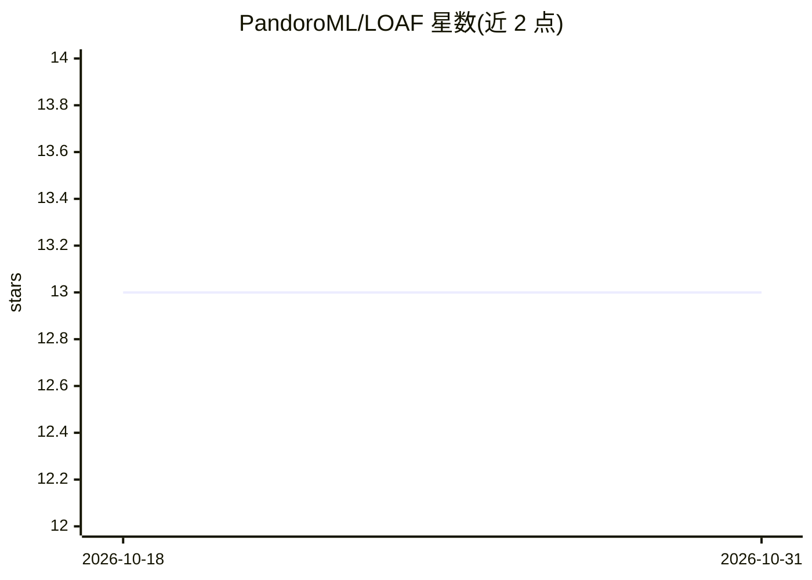

# PandoroML/LOAF

⭐ 13 · Python · MIT · 推送 2026-10-30 · [GitHub](https://github.com/PandoroML/LOAF) · [官网](https://pandoroml.github.io/LOAF/) · 组织维护

**给 DIY 硬件爱好者与科研用户：开源超本地天气预测工具**

LOAF 将 NOAA GFS/HRRR/ERA5 等区域格点预报与本地气象站观测融合，用多模态 transformer（MPNN/ViT）训练模型，修正大尺度预报的局地偏差，生成超本地风力多时程预测。数据流为本地传感器→树莓派存储与推理→通过 REST API 提供预测并可接入 Home Assistant。硬件侧采用自制超声波风速仪与树莓派记录器，太阳能供电可远程部署。提供 loaf-pipeline 等命令行工具链（下载→训练→REST 服务），自述为进行中的项目。

## 筛选速览

| 维度 | 判定 | 备注 |
|---|---|---|
| AI 角色 | `ai-native` | 本体是模型或模型工具 |
| 许可风险 | `permissive` | MIT |
| 部署形态 | `library` | 以包/库形式分发 |
| 模型依赖 | — | README 未给出锁定关系 |
| 硬件要求 | — | 无带数字的原话,不猜 |
| 安装摩擦 | `low` | 无编译、无系统依赖或容器化 |
| 成熟度 | `idea` | |

## 能力要点

- 融合格点预报（GFS/HRRR/ERA5）与本地站观测的多模态 transformer 训练
- loaf-pipeline 一条命令串起下载→训练→REST 服务预测
- 预测含 u/v 风分量与派生风速风向，可接入 Home Assistant REST sensor
- 开源硬件方案：自制超声波风速仪、树莓派记录器、太阳能供电

## 适用场景

- 在无气象站覆盖的偏远站点获得更准的本地风力预报
- 为科研或环境监测搭建可复现的本地预报基础设施
- 将超本地预报接入家庭自动化做告警与仪表盘

## 场景标签

`科研工具` `模型训练` · 领域:学习与行业

## 证据(README 行号)

> L28: 2. **Forecast Processing**: The Pi runs the trained ML model, combining local sensor data with regional forecasts (
> L54: LOAF generates hyperlocal weather forecasts for locations without nearby weather stations by combining:
> L62: - Paper: Yang, Q., et al. (2024). *Local Off-Grid Weather Forecasting with Multi-Modal Earth Observation Data.* arX

## 星数曲线

2026-10-18 13 → 2026-10-31 13（+0）

---
*卡片 v1 · prompt 1.4 · 生成 2026-10-31 · 置信度 high · 依据 README sha `1052b135bfa5` · [字段定义](../../DATASET.md)*
