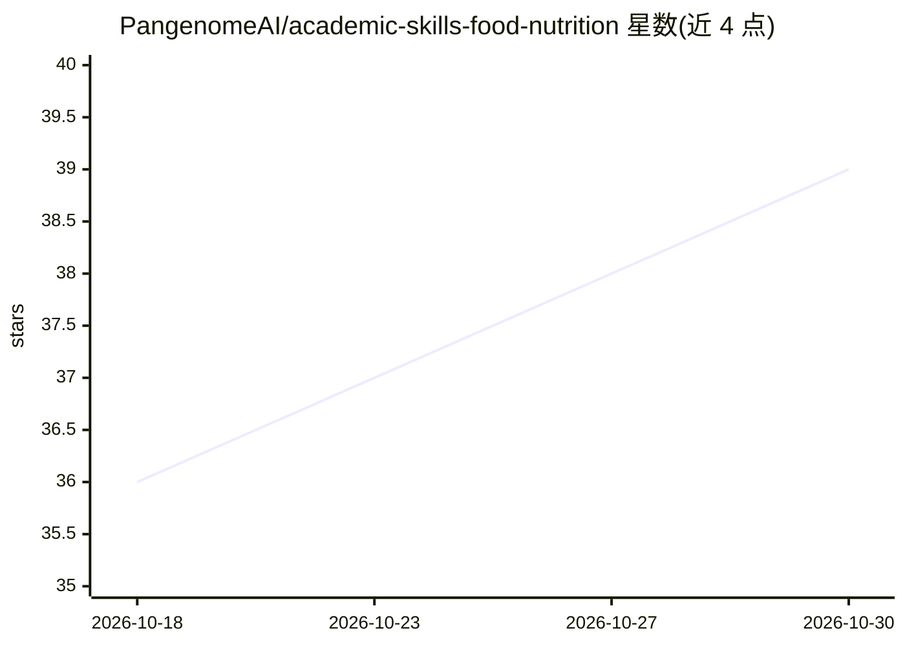

# PangenomeAI/academic-skills-food-nutrition

⭐ 39 · Python · MIT · 推送 2026-08-31 · [GitHub](https://github.com/PangenomeAI/academic-skills-food-nutrition) · 组织维护

**食品营养与农业科研的 AI agent 技能集：文献综述、写作、评审全流程**

墨尔本大学食品科学组发起的 MIT 开源技能集，为 Claude Code、Codex、MiniMax Agent、OpenClaw、Grok Build 提供覆盖科研全生命周期（研究→写作→评审→修改→定稿）的技能：文献发现与证据合成、PRISMA 系统综述、多审稿人同行评审、图表生成、可编辑 PPTX、合法全文获取（food-fetch，不绕过付费墙）。两套平行技能集 food-* 与 agri-* 共享一个引擎，每个核心技能为多子代理系统，内置 150+ 期刊作者指南，由 food-pipeline 主编排器路由。需先配置全文访问（文献管理器库/机构访问/仅开放获取）以保证准确性。

## 筛选速览

| 维度 | 判定 | 备注 |
|---|---|---|
| AI 角色 | `ai-knowledge` | 知识聚合/清单类 |
| 许可风险 | `permissive` | MIT |
| 部署形态 | `None` |  |
| 模型依赖 | locked-api |  |
| 硬件要求 | — | 无带数字的原话,不猜 |
| 安装摩擦 | `low` | 无编译、无系统依赖或容器化 |
| 成熟度 | — | 结构信号不足 |

## 能力要点

- 覆盖研究→写作→评审→修改全流程的技能集，每个核心技能为多子代理系统
- PRISMA 2020 系统综述流：≥3 数据库、三步独立筛选、OHAT 偏倚风险、流程图
- food-fetch 合法全文获取：开放获取/本地文献库/机构登录会话，不绕过付费墙与 2FA
- 支持 Claude Code、Codex、MiniMax Agent、OpenClaw、Grok Build，一键安装脚本

## 适用场景

- 让 agent 做食品营养领域的文献综述或系统综述并输出 Word 稿
- 投稿前跑多角色同行评审与期刊格式合规检查
- 从综述或稿件生成可编辑的 PPTX 汇报演示
- 农业科学（agri-*）方向的同流程科研自动化

## 场景标签

`科研工具` `AI 写作` · 领域:内容生成

## 证据(README 行号)

> L14: Original, **MIT-licensed** skills for the food, nutrition & agriculture research
> L23: This open project was **initiated by the Food Science Group at the University of

## 星数曲线

2026-10-18 36 → 2026-10-30 39（+3）

---
*卡片 v1 · prompt 1.4 · 生成 2026-10-25 · 置信度 high · 依据 README sha `9ce2bfbfb983` · [字段定义](../../DATASET.md)*
