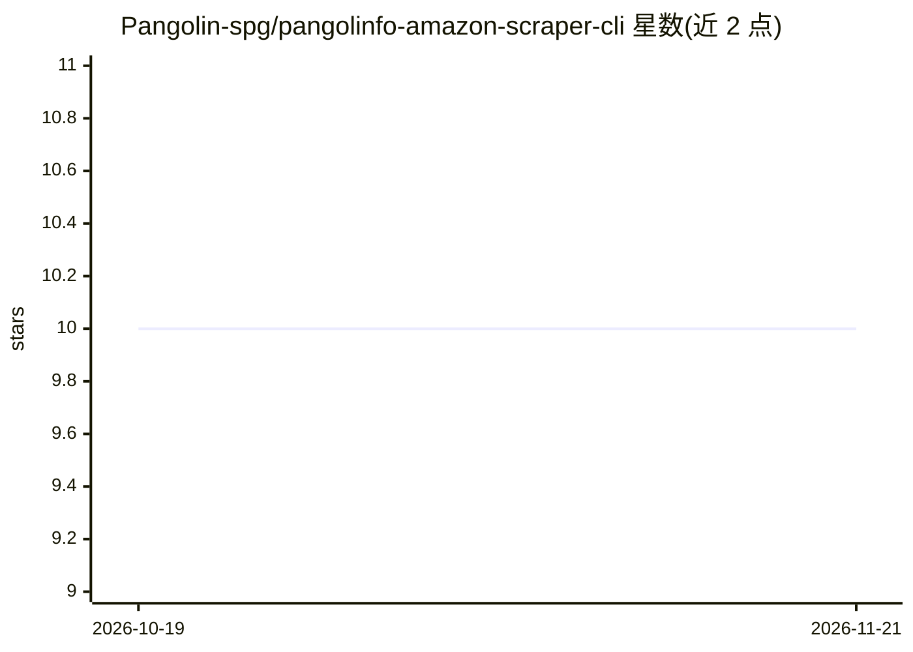

# Pangolin-spg/pangolinfo-amazon-scraper-cli

⭐ 10 · Python · 推送 2026-05-12 · [GitHub](https://github.com/Pangolin-spg/pangolinfo-amazon-scraper-cli) · [官网](https://www.pangolinfo.com/) · 组织维护 · 中文 README

**调用 Pangolinfo API 采集 Amazon 数据的 CLI，输出供 Agent 使用的 JSON/Markdown**

开源 Python CLI，封装 Pangolinfo 的 Amazon Scrape API、Review API、General Scrape API 与 Niche Data API，提供商品详情、关键词搜索、评论、榜单、卖家/类目列表、类目树与利基过滤等子命令，输出 JSON/CSV/Markdown 并支持 --dry-run 预检请求。使用前提为 Python 3.9+ 和 Pangolinfo 账号的 Token 或 API 凭据（云端付费/试用积分模式），本仓库不做本地爬取解析。面向需要实时结构化 Amazon 数据的开发者与 Agent/RAG 管道。

## 筛选速览

| 维度 | 判定 | 备注 |
|---|---|---|
| AI 角色 | `ai-enhanced` | 去掉 AI 部分产品仍成立 |
| 许可风险 | `none` | — |
| 部署形态 | `library` | 以包/库形式分发 |
| 模型依赖 | — | README 未给出锁定关系 |
| 硬件要求 | — | 无带数字的原话,不猜 |
| 安装摩擦 | `low` | 无编译、无系统依赖或容器化 |
| 成熟度 | — | 结构信号不足 |

## 能力要点

- 覆盖商品、关键词、评论、榜单、卖家、类目与利基指标等子命令
- 输出 JSON/CSV/Markdown，支持 --dry-run 打印请求不发请求
- 支持 openclaw skills 安装官方 Amazon Scraper / Niche Skill 供 Agent 调用
- 请求/响应落盘，便于审计、对账与回放

## 适用场景

- 追踪 Amazon 关键词排名与竞品价格变化
- 批量导出商品评论做分析
- 为 Agent 工具层接入实时结构化电商数据
- 为 RAG 管道生成可切块检索的 Markdown 文本

## 场景标签

`网页抓取` · 领域:效率与自动化

## 证据(README 行号)

> L5: 如果你需要 **高效、低成本、快速** 地采集 Amazon 数据（商品、关键词搜索、评论、榜单、类目/利基指标），这个项目提供一个“可复制命令、可审计请求、可落盘输出”的开源 CLI：直接调用 Pangolinfo 的官方接口，输
> L44: 这个 CLI 的目标不是“模拟浏览器爬网页”，而是把 Pangolinfo 的实时数据能力封装成更适合开发者与 Agent 的交互方式：参数可控、输出可控、且完全对齐官方文档。

## 星数曲线

2026-10-19 10 → 2026-11-21 10（+0）

---
*卡片 v1 · prompt 1.4 · 生成 2026-11-20 · 置信度 mid · 依据 README sha `30f50fccd55c` · [字段定义](../../DATASET.md)*
