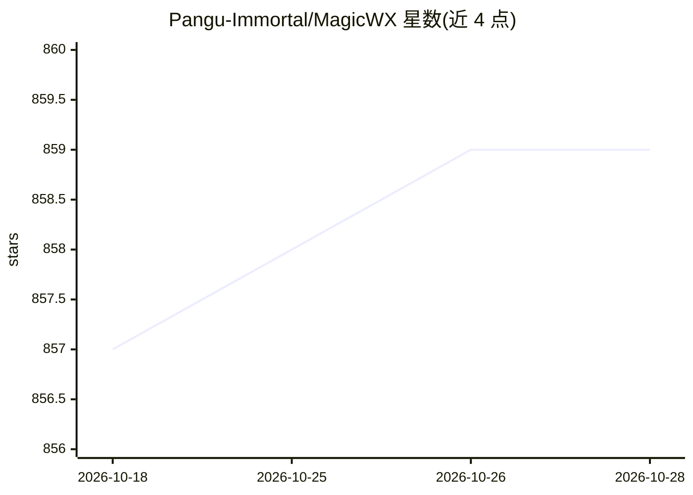

# Pangu-Immortal/MagicWX

⭐ 859 · Kotlin · MIT · 推送 2026-09-06 · [GitHub](https://github.com/Pangu-Immortal/MagicWX) · 个人维护 · 中文 README

**Android 端侧离线 LLM 聊天与本地生图应用**

面向 Android 17（API 37）的本地 AI 应用，用 Kotlin / Jetpack Compose / Material3 构建：完全离线的文本聊天（RWKV / ONNX / MediaPipe-LiteRT 运行时适配器），加端侧 Stable Diffusion SD1.5 CPU 生图（txt2img / img2img / inpaint，MNN 原生后端）。区分“已注册”与“已验证”模型，候选模型需通过包清单、加载与真机验证后才可见；后台模型下载走前台服务，支持断点续传与 HF 镜像回退。v1.1.5 原型阶段，GitHub Releases 提供 APK，非 Play 生产构建。

## 筛选速览

| 维度 | 判定 | 备注 |
|---|---|---|
| AI 角色 | `ai-native` | 本体是模型或模型工具 |
| 许可风险 | `permissive` | MIT |
| 部署形态 | `None` |  |
| 模型依赖 | — | README 未给出锁定关系 |
| 硬件要求 | — | 无带数字的原话,不猜 |
| 安装摩擦 | `medium` | 含编译或系统依赖之一 |
| 成熟度 | `idea` | |

## 能力要点

- 离线文本聊天（RWKV-7 / ONNX / MediaPipe-LiteRT 运行时）与内置体验模型
- 端侧 SD1.5 CPU 生图：txt2img / img2img / inpaint、蒙版绘制、持久历史
- 已注册模型需真机验证（下载、tokenizer、加载、dry-run）方可对用户可见
- 前台服务后台下载模型，支持 .downloading 断点续传与 HF 镜像回退

## 适用场景

- 在安卓设备上离线运行小参数 LLM 聊天（Qwen3 0.6B、RWKV-7 等）
- 无网络环境下本地生成与编辑图像
- 试验 Android 17 端侧多模态模型候选（ASR/TTS/VLM 列入队列）

## 场景标签

`图像生成` `聊天机器人` · 领域:对话与助手

## 证据(README 行号)

> L3: MagicWX is an Android local AI app built with Kotlin, Jetpack Compose, and Material3. It combines fully offline text
> L12: - **Local image generation (GA on CPU)**: SD1.5 CPU pipeline verified end-to-end on Samsung SM-A566E — txt2img / im

## 星数曲线

2026-10-18 857 → 2026-10-28 859（+2）

---
*卡片 v1 · prompt 1.4 · 生成 2026-10-21 · 置信度 high · 依据 README sha `4333ad87046f` · [字段定义](../../DATASET.md)*
