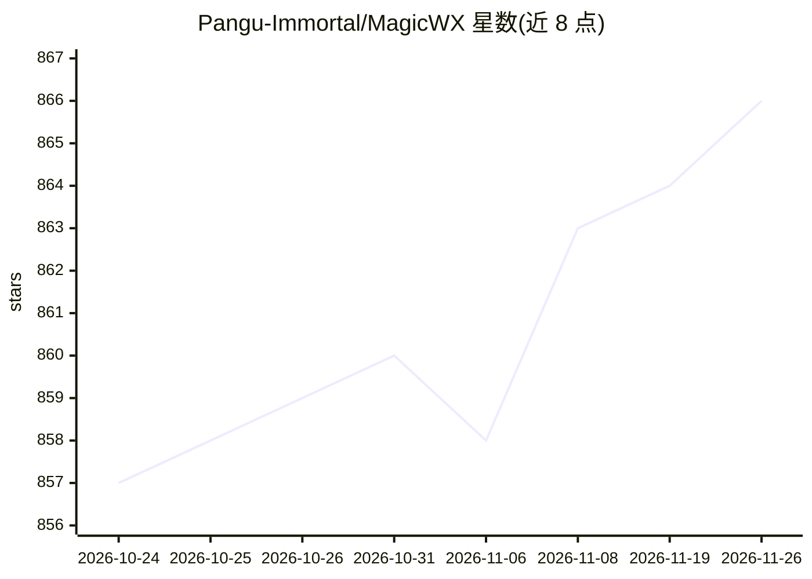

# Pangu-Immortal/MagicWX

⭐ 866 · Kotlin · NOASSERTION · 推送 2026-11-09 · [GitHub](https://github.com/Pangu-Immortal/MagicWX) · 个人维护 · 中文 README

**安卓端本地 LLM 与生图原型应用：离线聊天+文生图**

基于 Kotlin/Jetpack Compose/Material3 的 Android 本地 AI 应用：通过 BUILTIN、ONNX、LiteRT(MediaPipe) 等运行时适配器进行离线文本聊天，并通过 MNN 原生后端运行 SD1.5 CPU 流水线进行文生图/图生图/局部重绘，带遮罩绘制、参数面板与 Room 持久化历史。原型针对 Android 17 / API 37，GitHub Releases 提供 APK。模型注册与候选池分离：仅通过真机验证的模型在应用中可见，其余处于隐藏状态等待验证。

## 筛选速览

| 维度 | 判定 | 备注 |
|---|---|---|
| AI 角色 | `ai-native` | 本体是模型或模型工具 |
| 许可风险 | `none` | NOASSERTION |
| 部署形态 | `None` |  |
| 模型依赖 | — | README 未给出锁定关系 |
| 硬件要求 | — | 无带数字的原话,不猜 |
| 安装摩擦 | `medium` | 含编译或系统依赖之一 |
| 成熟度 | `idea` | |

## 能力要点

- 多运行时适配器：ONNX、LiteRT/MediaPipe、内置文本引擎与 MNN 图像后端（localhost:18081 SSE 流式）
- SD1.5 CPU 生图流水线：txt2img/img2img/inpaint，真机验证约 10-14s/512×512 步
- 注册模型真机验证机制：包清单、tokenizer、加载与设备日志检查全部通过才可见
- 后台前台服务下载，支持断点续传与 HF 镜像回退源

## 适用场景

- 在安卓手机上离线运行 RWKV、Qwen、SmolLM2 等小模型聊天
- 在端侧离线生成和编辑图像（文生图/局部重绘）
- 验证移动端 LLM/生图模型在真机上的加载与推理表现

## 场景标签

`聊天机器人` `图像生成` `AI 助手` · 领域:对话与助手

## 证据(README 行号)

> L7: MagicWX is an Android local AI app built with Kotlin, Jetpack Compose, and Material3. It combines fully offline text
> L22: The repository intentionally distinguishes registered model candidates from verified GA support. Do not describe a 
> L57: This catalog is a research and implementation queue, not a support claim. Only the registered models above are visi

## 星数曲线

2026-10-24 857 → 2026-11-26 866（+9）

---
*卡片 v1 · prompt 1.4 · 生成 2026-11-24 · 置信度 high · 依据 README sha `8f49bfb9704a` · [字段定义](../../DATASET.md)*
