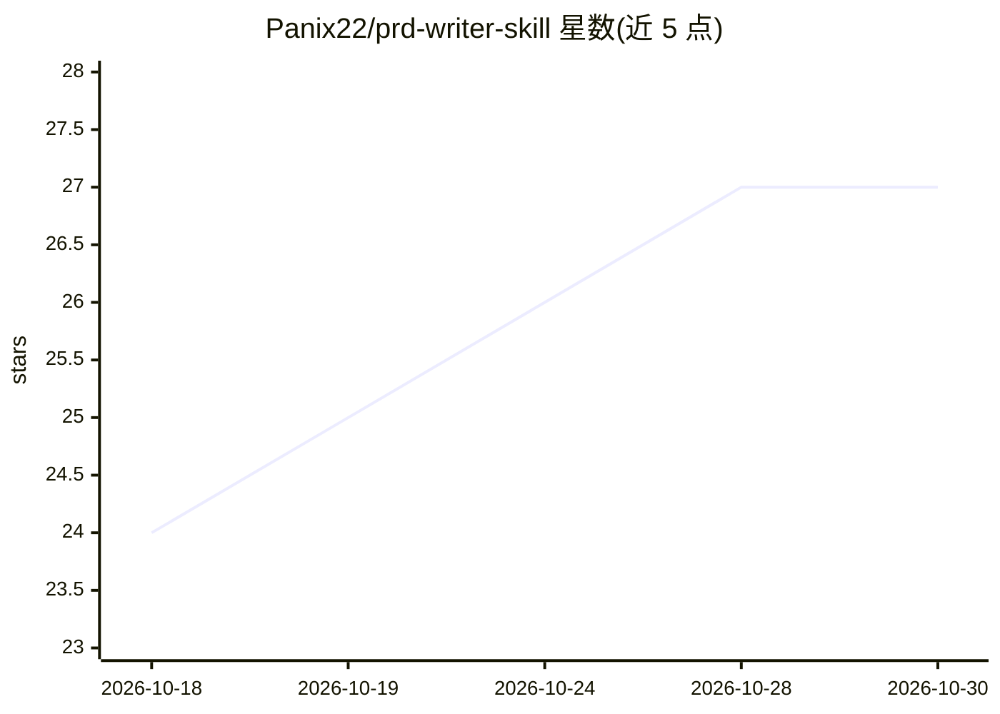

# Panix22/prd-writer-skill

⭐ 27 · MIT · 推送 2026-06-04 · [GitHub](https://github.com/Panix22/prd-writer-skill) · 个人维护 · 中文 README

**引导式对话产出中文落地版 PRD 的通用 Agent 技能**

以 Agent Skill 形式分发的技能：在支持 skills 格式的 AI 助手（Claude Code、Codex、Hermes、OpenClaw 等）中运行，从用户/业务/技术三个视角分轮访谈（每轮最多 3 个问题），先产出精简概念 PRD 与用户对齐并冻结范围，再生成含用户流程、状态机、字段规则、文案与异常处理的落地版中文 PRD，声明不留 TBD 占位。安装依赖 Node，通过 npx skills 命令装入对应 agent 的 skills 目录，仓库含 SKILL.md 与 PRD 模板两个文件。

## 筛选速览

| 维度 | 判定 | 备注 |
|---|---|---|
| AI 角色 | `ai-native` | 本体是模型或模型工具 |
| 许可风险 | `permissive` | MIT |
| 部署形态 | `library` | 以包/库形式分发 |
| 模型依赖 | — | README 未给出锁定关系 |
| 硬件要求 | — | 无带数字的原话,不猜 |
| 安装摩擦 | `low` | 无编译、无系统依赖或容器化 |
| 成熟度 | — | 结构信号不足 |

## 能力要点

- 三视角分阶段访谈 + 概念 PRD 冻结范围后再产出落地版
- 落地版 PRD 覆盖流程（正常+异常）、状态机、字段、文案规则
- 不绑定特定工具，任何支持 Agent Skill 格式的助手可用
- npx skills 一行命令安装，支持指定 agent 或全部 agent

## 适用场景

- 我想把一个模糊的产品想法聊成一份可开发的中文 PRD
- 给 vibe-coding / MVP 项目快速界定功能范围与边界
- 让 AI 助手以固定流程替代一次性生成需求文档

## 场景标签

`AI 写作` · 领域:内容生成

## 证据(README 行号)

> L3: > **A conversational PRD-writing Agent Skill.** It interviews you from the user, business, and technical angles, ali
> L7: 一个通用的 Agent 技能（skill）：引导式产品需求发现对话，分阶段产出标准中文 PRD 文档。不绑定特定工具，凡是支持 skills 的 AI 助手都能用。
> L9: 它不会一上来就甩给你一份完整 PRD，而是先从**用户 / 业务 / 技术**三个视角做诊断，确认页面结构与导航，输出一份简洁的**概念 PRD** 与你对齐、冻结范围，再生成包含流程、状态、字段、文案与异常处理的**落地版 PRD

## 星数曲线

2026-10-18 24 → 2026-10-30 27（+3）

---
*卡片 v1 · prompt 1.4 · 生成 2026-10-26 · 置信度 high · 依据 README sha `866464009584` · [字段定义](../../DATASET.md)*
