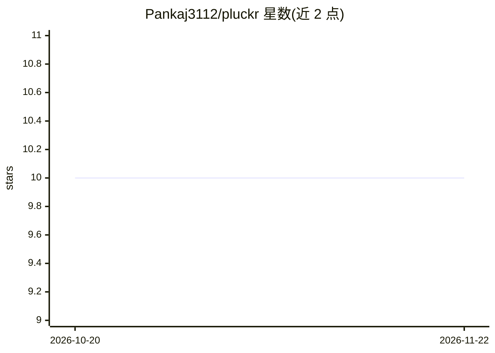

# Pankaj3112/pluckr

⭐ 10 · TypeScript · MIT · 推送 2026-06-17 · [GitHub](https://github.com/Pankaj3112/pluckr) · 个人维护

**用 LLM 自动生成自愈选择器的网页数据抽取库**

面向开发者的 TypeScript 抽取库：用户以 Zod schema 定义要抽取的数据，LLM 通过 agentic 工具循环为每个字段生成 CSS 选择器，先验证再缓存；页面变化导致选择器失效时自动修复，缓存命中时抽取零 LLM 调用。HTML 来源由用户自备（fetch、Puppeteer、Playwright、curl），存储默认内存，可选 SQLite/Redis 后端，支持任意 Vercel AI SDK 模型。npm 安装，MIT 许可。

## 筛选速览

| 维度 | 判定 | 备注 |
|---|---|---|
| AI 角色 | `ai-native` | 本体是模型或模型工具 |
| 许可风险 | `permissive` | MIT |
| 部署形态 | `library` | 以包/库形式分发 |
| 模型依赖 | — | README 未给出锁定关系 |
| 硬件要求 | — | 无带数字的原话,不猜 |
| 安装摩擦 | `low` | 无编译、无系统依赖或容器化 |
| 成熟度 | — | 结构信号不足 |

## 能力要点

- Zod schema 定义抽取目标，返回全类型化结果
- LLM 生成 CSS 选择器并自动验证与缓存
- 页面变更时选择器自愈，缓存命中时零 LLM 调用
- 可插拔存储：内存默认，含 SQLite 与 Redis 后端

## 适用场景

- 网站结构经常变动、不想维护选择器的数据采集
- 对 JS 渲染的单页应用做结构化抽取
- 分布式部署下共享选择器缓存

## 场景标签

`网页抓取` · 领域:效率与自动化

## 证据(README 行号)

> L3: Schema-first, self-healing HTML data extraction powered by LLMs. Define what you want with a Zod schema, and Pluckr 
> L25: 2. An LLM generates CSS selectors for each field via an agentic tool loop
> L62: - **BYO model** — works with any Vercel AI SDK model (Google, Anthropic, OpenAI, etc.)

## 星数曲线

2026-10-20 10 → 2026-11-22 10（+0）

---
*卡片 v1 · prompt 1.4 · 生成 2026-11-20 · 置信度 high · 依据 README sha `5643e2be6f2e` · [字段定义](../../DATASET.md)*
