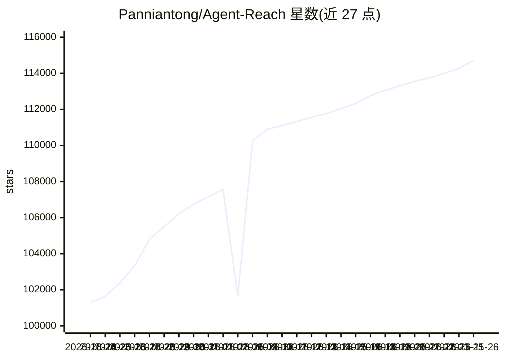

# Panniantong/Agent-Reach

⭐ 114,709 · Python · MIT · 推送 2026-11-24 · [GitHub](https://github.com/Panniantong/Agent-Reach) · 个人维护 · 中文 README

**为 AI Agent 提供多平台网页搜索与读取的 CLI 工具**

一个命令行工具，把 X、Reddit、YouTube、B站、小红书、V2EX、雪球等平台的搜索与读取能力封装成 Agent 可调用的命令。每个平台维护一个首选+备选的有序工具列表，失败自动切换。默认渠道无需登录即可用，登录类平台使用专用后台浏览器并复用本地已有登录，建议使用小号；仅支持只读操作。安装通过 install.md 由 Agent 自行完成，工具集中在 ~/.agent-reach/ 目录管理。

## 筛选速览

| 维度 | 判定 | 备注 |
|---|---|---|
| AI 角色 | `ai-ecosystem` | LLM/agent 周边工具 |
| 许可风险 | `permissive` | MIT |
| 部署形态 | `library` | 以包/库形式分发 |
| 模型依赖 | — | README 未给出锁定关系 |
| 硬件要求 | — | 无带数字的原话,不猜 |
| 安装摩擦 | `low` | 无编译、无系统依赖或容器化 |
| 成熟度 | — | 结构信号不足 |

## 动量与使用信号

- 维护:`active` — 距上次 push 2.8 天,年发版 7,36 位贡献者
- 涨星:近 1 天 **+712**(自 20261016 起算)
- 平台:— · 协议:MCP

## 能力要点

- 一个 CLI 封装 13 个平台的搜索与读取动作（agent-reach <渠道> <动作>）
- 每平台首选+备选工具列表，失败自动切换
- 专用后台浏览器复用本地登录，不读密码库，只读不发帖
- 支持视频字幕与语音转文字（YouTube/小宇宙）

## 适用场景

- 让 Agent 搜索小红书、B站等中文平台内容
- 读取 YouTube 字幕与播客转文字
- 获取 V2EX、GitHub、雪球的结构化数据

## 场景标签

`网页抓取` · 领域:效率与自动化

## 证据(README 行号)

> L3:  让 AI Agent 够得着它自己上不去的互联网
> L49: Agent Reach 把这些平台背后的工具替你装好、测好，Agent 一条命令就能用：
> L128: 每个平台的每个动作都有一个按顺序尝试的工具列表。比如读 B站视频先用 bili-cli，失败了自动换 B站公开接口；读网页先用 Jina Reader，再用 Exa。

## 星数曲线

2026-10-24 101,295 → 2026-11-26 114,709（+13,414）

---
*卡片 v1 · prompt 1.4 · 生成 2026-11-22 · 置信度 mid · 依据 README sha `55b959e642c3` · [字段定义](../../DATASET.md)*
