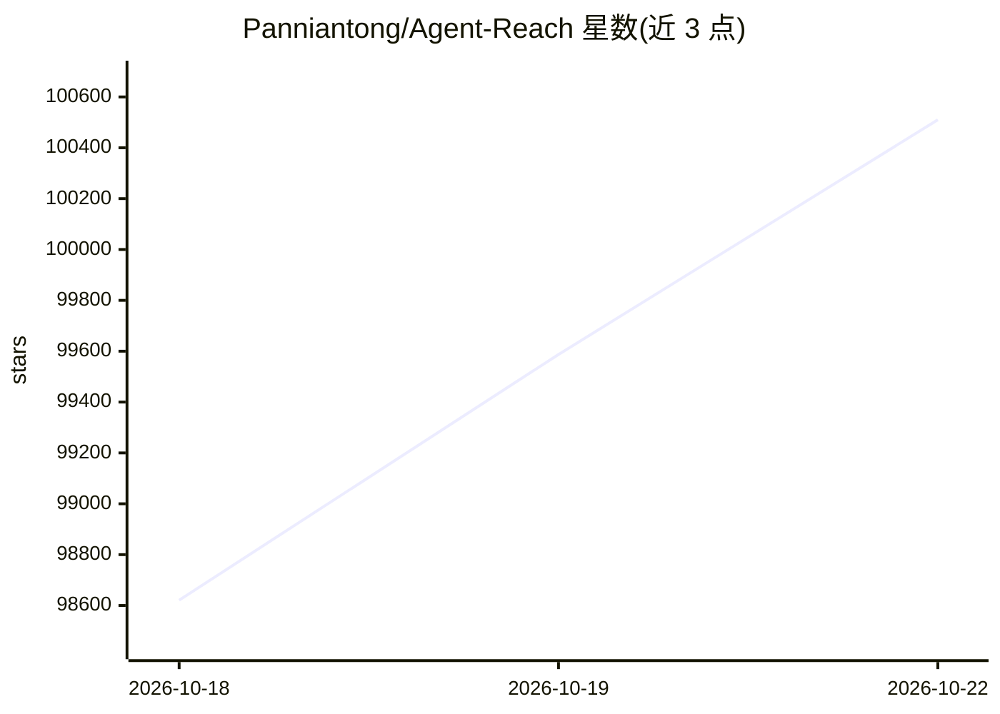

# Panniantong/Agent-Reach

⭐ 100,964 · Python · MIT · 推送 2026-10-20 · [GitHub](https://github.com/Panniantong/Agent-Reach) · 个人维护 · 中文 README

**给 AI Agent 一键配置读取与搜索互联网渠道的 CLI 能力层**

Agent Reach 定位为能力层：为 Claude Code、OpenClaw、Cursor 等可执行命令行的 Agent 选型、安装并体检各平台的读取工具，覆盖网页、YouTube、RSS、GitHub、Twitter、B站、Reddit、小红书等 17 个渠道。每个平台维护「首选+备选」的有序后端列表，按序真实探测选择可用路径，接入方式失效时切换路由。凭据仅存本地，`agent-reach doctor` 可诊断各渠道状态；安装默认只读检查，显式 `--system` 才修改系统。

## 筛选速览

| 维度 | 判定 | 备注 |
|---|---|---|
| AI 角色 | `ai-native` | 本体是模型或模型工具 |
| 许可风险 | `permissive` | MIT |
| 部署形态 | `library` | 以包/库形式分发 |
| 模型依赖 | — | README 未给出锁定关系 |
| 硬件要求 | — | 无带数字的原话,不猜 |
| 安装摩擦 | `low` | 无编译、无系统依赖或容器化 |
| 成熟度 | — | 结构信号不足 |

## 动量与使用信号

- 维护:`active` — 距上次 push 2.8 天,年发版 7,36 位贡献者
- 涨星:近 1 天 **+712**(自 20261016 起算)
- 平台:— · 协议:MCP

## 能力要点

- 17 个平台渠道，6 个零配置即用，其余按引导配置登录态
- 每平台「首选+备选」多后端路由，失效自动换路径
- agent-reach doctor 一条命令诊断各渠道可用性
- 凭据本地存储、默认不修改系统的安全安装流程

## 适用场景

- 让 Agent 帮我读 YouTube 字幕、搜 B站、刷小红书内容
- 给新装的 Agent 一句话配好各平台读取环境
- 平台接口被封后不用自己折腾，切换到可用路由

## 场景标签

`网页抓取` · 领域:效率与自动化

## 证据(README 行号)

> L75: |🤖 **兼容所有 Agent**|Claude Code、OpenClaw、Cursor、Windsurf……任何能跑命令行的 Agent 都能用|
> L165: **Agent Reach 是一个能力层（capability layer），不是又一个工具。**
> L178: ├── twitter.py      → twitter-cli ▸ OpenCLI ▸ bird

## 星数曲线

2026-10-18 98,621 → 2026-10-22 100,510（+1,889）

---
*卡片 v1 · prompt 1.4 · 生成 2026-10-18 · 置信度 mid · 依据 README sha `4c1687bc7263` · [字段定义](../../DATASET.md)*
