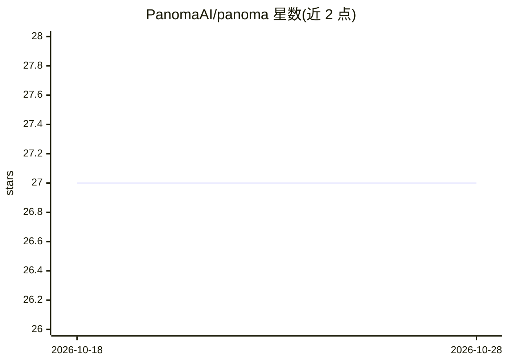

# PanomaAI/panoma

⭐ 27 · TypeScript · AGPL-3.0 · 推送 2026-09-18 · [GitHub](https://github.com/PanomaAI/panoma) · [官网](https://panoma.ai) · 个人维护 · 中文 README

**本地项目目录：盘点磁盘上全部项目，供本人与 AI agent 使用**

以 CLI（npx panoma scan）扫描本地文件夹，为每个项目生成卡片：技术栈、依赖、健康分、分发目标、未提交/未推送的成果及 git trailer 中的 AI agent 归因。提供 App Store 风格 Web 界面、watcher 自动收录新项目、七类生态的版本与 OSV 漏洞查询、隔离环境中的更新提案，以及 MCP server 供 Claude Code/Cursor/Gemini CLI/Codex 等 agent 接入，含记忆契约、预算与 Twin 学习等机制。面向持有大量本地项目的开发者，本地优先、代码不上传。

## 筛选速览

| 维度 | 判定 | 备注 |
|---|---|---|
| AI 角色 | `ai-enhanced` | 去掉 AI 部分产品仍成立 |
| 许可风险 | `viral` | AGPL-3.0 |
| 部署形态 | `library` | 以包/库形式分发 |
| 模型依赖 | — | README 未给出锁定关系 |
| 硬件要求 | — | 无带数字的原话,不猜 |
| 安装摩擦 | `low` | 无编译、无系统依赖或容器化 |
| 成熟度 | — | 结构信号不足 |

## 能力要点

- 识别 npm/Flutter/PyPI/Go/Cargo/RubyGems/Composer 等 7 类生态，83 条技术识别规则
- 通过 git Co-Authored-By trailer 追溯每个提交背后的 AI agent
- MCP server 为 agent 提供上下文、日志、任务队列与受审批约束的项目记忆
- git worktree 隔离执行更新提案：跑测试后留分支，不改动原文件夹、不推送

## 适用场景

- 把散落在磁盘上的几十个项目做成可浏览的健康目录
- 查哪些项目有只存在于本机的提交、已提交的密钥、未被引用的资源
- 让 Claude Code/Cursor 等 agent 通过 MCP 读取项目目录与记忆
- 跨全部项目搜索代码并生成每日变更简报

## 场景标签

 · 领域:开发者工具/agent 基础设施

## 证据(README 行号)

> L27: `panoma` is a **local project catalog**—think of it as the App Store for your own projects.
> L39: **Local and working end to end**—engine, catalog, web app, CLI, MCP server, and proposal
> L53: - [x] MCP server with context, journal, and project task queue for agents

## 星数曲线

2026-10-18 27 → 2026-10-28 27（+0）

---
*卡片 v1 · prompt 1.4 · 生成 2026-10-26 · 置信度 mid · 依据 README sha `c2dec4ee87d7` · [字段定义](../../DATASET.md)*
