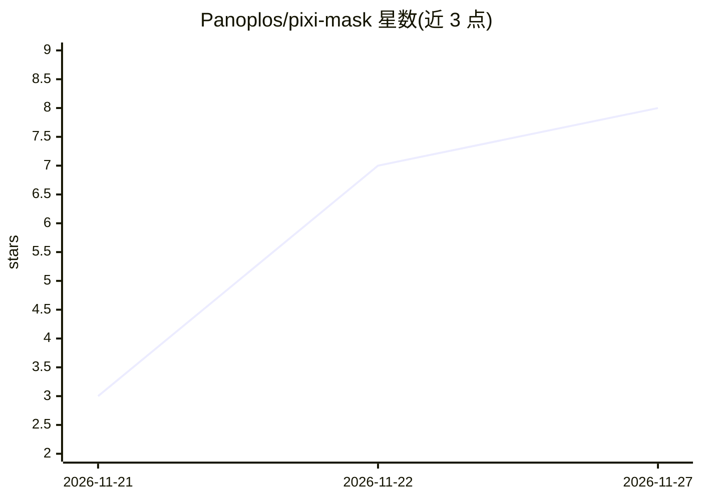

# Panoplos/pixi-mask

⭐ 8 · Rust · MIT · 推送 2026-11-13 · [GitHub](https://github.com/Panoplos/pixi-mask) · 个人维护

**在文本进入模型上下文前掩蔽密钥的 CLI 与 Rust 库**

面向编码 agent 场景的密钥掩蔽工具：stdin 输入文本，值被替换为 …[REDACTED] 后输出，同时给出 JSON 发现清单；名称保留、值被遮蔽，使 agent 仍能理解代码但拿不到密钥。内置 vendored 的 betterleaks 452 条规则，采用关键词预过滤→规则正则→熵门控三级流程，支持 base64/hex/percent 编码段解码重扫，并可从 auth.json、.env、aws credentials 等本地文件读取已知密钥做精确匹配。提供 mask/scan/rules 三个子命令、Rust crate 库接口，以及 Pixi/pi 编码 agent 的现成 hook（key-guard.ts）。限制：不做 provider API 验证、不捕获无标签的纯高熵串、不做路径型规则。

## 筛选速览

| 维度 | 判定 | 备注 |
|---|---|---|
| AI 角色 | `ai-ecosystem` | LLM/agent 周边工具 |
| 许可风险 | `permissive` | MIT |
| 部署形态 | `library` | 以包/库形式分发 |
| 模型依赖 | — | README 未给出锁定关系 |
| 硬件要求 | — | 无带数字的原话,不猜 |
| 安装摩擦 | `medium` | 含编译或系统依赖之一 |
| 成熟度 | — | 结构信号不足 |

## 能力要点

- vendored betterleaks 452 条规则 + 关键词预过滤/熵门控流水线
- 单个静态二进制，无运行时依赖、无网络调用，单次掩蔽约 5-12 ms
- base64/hex/percent 编码段解码重扫，每轮次上限可观测（skipped/complete 字段）
- 同时提供 CLI 与无全局状态的 Rust Scanner 库接口

## 适用场景

- 给编码 agent 的 hook 加密钥掩蔽，让工具结果安全进入模型上下文
- 在 CI 中用 scan 子命令批量检查文件是否含密钥
- 密钥轮换后无需重启即持续匹配本地凭据文件中的已知值
- 作为 Rust 依赖嵌入需要拒绝未扫描文本的服务入口

## 场景标签

`网络安全` · 领域:学习与行业

## 证据(README 行号)

> L197: It masks every tool result and every user message before either reaches the
> L205: On each hook call it runs `pixi-mask mask --json` (~5 ms), puts the returned

## 星数曲线

2026-11-21 3 → 2026-11-27 8（+5）

---
*卡片 v1 · prompt 1.4 · 生成 2026-11-22 · 置信度 mid · 依据 README sha `88da0de7dd04` · [字段定义](../../DATASET.md)*
