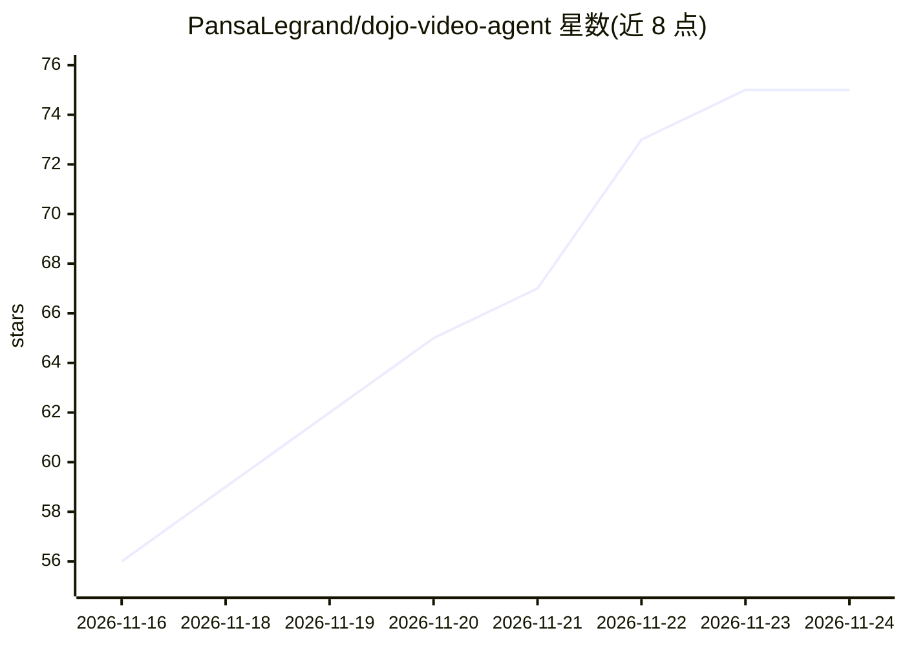

# PansaLegrand/dojo-video-agent

⭐ 81 · TypeScript · MIT · 推送 2026-11-22 · [GitHub](https://github.com/PansaLegrand/dojo-video-agent) · [官网](https://github.com/PansaLegrand/dojo-video-engine) · 组织维护

**开源本地视频编辑器：人与 AI agent 共用同一条时间线**

基于 TypeScript 的本地运行视频编辑器，用户可手工剪辑或通过对话让 AI agent 执行编辑，两者共享同一 ProjectDocument 与历史记录，命令经校验后应用，支持 Compare 与 Undo。浏览器内完成预览与 MP4 导出，手动编辑、字幕导入无需任何 API key；聊天编辑需自带 GPT Responses API key，语音转录支持 OpenAI 兼容端点与 ElevenLabs Scribe，可选 Kie 音乐生成。密钥保存于本地服务器私有目录。单用户回环地址设计，不作为公共服务部署。商业托管版 DojoClip 为独立产品。

## 筛选速览

| 维度 | 判定 | 备注 |
|---|---|---|
| AI 角色 | `ai-enhanced` | 去掉 AI 部分产品仍成立 |
| 许可风险 | `permissive` | MIT |
| 部署形态 | `library` | 以包/库形式分发 |
| 模型依赖 | — | README 未给出锁定关系 |
| 硬件要求 | — | 无带数字的原话,不猜 |
| 安装摩擦 | `medium` | 含编译或系统依赖之一 |
| 成熟度 | — | 结构信号不足 |

## 能力要点

- 手工编辑与对话式 AI agent 编辑共享同一时间线与历史，支持 Compare/Undo
- 本地浏览器内渲染与导出 MP4，手动编辑与字幕导入无需 API key
- BYOK 模式：GPT Responses API、ASR、Kie 音乐密钥按需配置
- agent 可检查来源、读取技能、执行经验证的修正轮次并导出绑定版本

## 适用场景

- 本地导入素材并手工剪辑、加字幕、导出 MP4
- 通过对话让 AI 修改标题、生成双语字幕、添加动画片头片尾
- 在不出送素材的前提下试用可编辑的示例工程（无需 key）

## 场景标签

`视频生成` · 领域:内容生成

## 证据(README 行号)

> L6: **An open-source video editor where you and an AI agent work on the same timeline.** Run locally, bring your own mod
> L103: This is a local editing workflow. It needs neither an AI provider nor an account. Rendering and export run in the 
> L155: |Manual edits, subtitle import, preview, MP4 export|None|

## 星数曲线

2026-11-16 56 → 2026-11-24 75（+19）

---
*卡片 v1 · prompt 1.4 · 生成 2026-11-18 · 置信度 high · 依据 README sha `81f7894750eb` · [字段定义](../../DATASET.md)*
