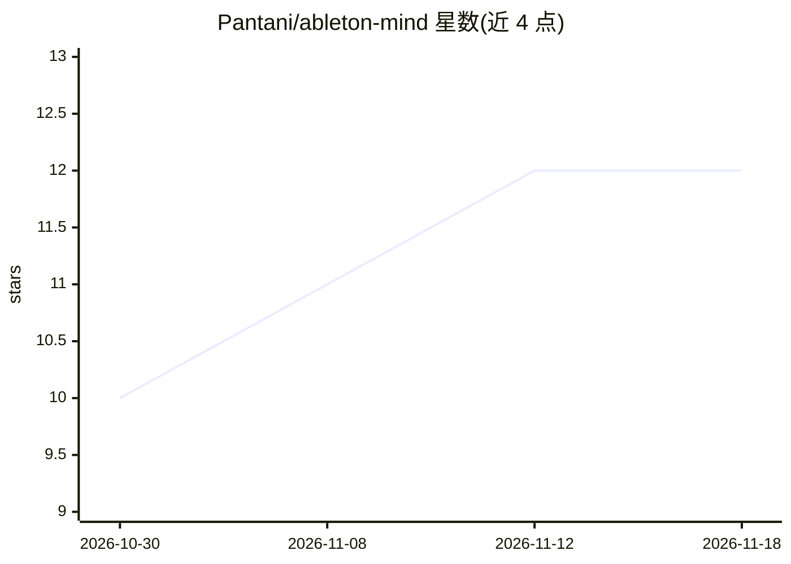

# Pantani/ableton-mind

⭐ 12 · TypeScript · MIT · 推送 2026-11-11 · [GitHub](https://github.com/Pantani/ableton-mind) · [官网](https://pantani.xyz/ableton-mind) · 个人维护

**面向 Ableton Live 的 MCP 服务器：让 LLM 操作 Live 创作音乐**

TypeScript 编写的 MCP 服务器，将 Ableton Live 的 Live Object Model 全量暴露给 LLM（Claude、Cursor 等），内置设备知识库（55 种设备、音阶、鼓组）、14 条声明式音乐 recipe、集成 verify loop（session_snapshot/diff）与 7 类响应式监听事件。三层架构：MCP server 经 TCP NDJSON 连接 Live 内运行的 Python Remote Script。需 Node 20+ 与 Live 12（兼容 11），macOS 为主，API 尚不稳定。

## 筛选速览

| 维度 | 判定 | 备注 |
|---|---|---|
| AI 角色 | `ai-ecosystem` | LLM/agent 周边工具 |
| 许可风险 | `permissive` | MIT |
| 部署形态 | `self-host` | docker 或自建部署 |
| 模型依赖 | local-ok | 支持本地模型 |
| 硬件要求 | — | 无带数字的原话,不猜 |
| 安装摩擦 | `low` | 无编译、无系统依赖或容器化 |
| 成熟度 | `idea` | |

## 能力要点

- 36 个 MCP 工具，覆盖约 100% 的 Live Object Model
- 内置 55 设备知识库与 14 条声明式 recipe
- 集成 verify loop 与事务（undo unitary）支持
- 提供本地 copilot：通过 OpenAI 兼容端点接入本地 LLM

## 适用场景

- 用自然语言在 Ableton Live 中搭建鼓组与贝斯线
- 让 Claude/Cursor 通过 MCP 直接控制 Live 工程
- 本地运行小型 LLM 做只读的工程问答

## 场景标签

`AI 助手` · 领域:对话与助手

## 证据(README 行号)

> L5: Definitive MCP (Model Context Protocol) server for **Ableton Live**. Exposes the full **Live Object Model** to LLMs 
> L16: Claude/Cursor ──MCP/stdio──▶ ableton-mind (TS, Node 20+) ──TCP NDJSON JSON-RPC──▶ Remote Script (Python, inside Liv

## 星数曲线

2026-10-30 10 → 2026-11-18 12（+2）

---
*卡片 v1 · prompt 1.4 · 生成 2026-11-18 · 置信度 high · 依据 README sha `50b3b80237e8` · [字段定义](../../DATASET.md)*
