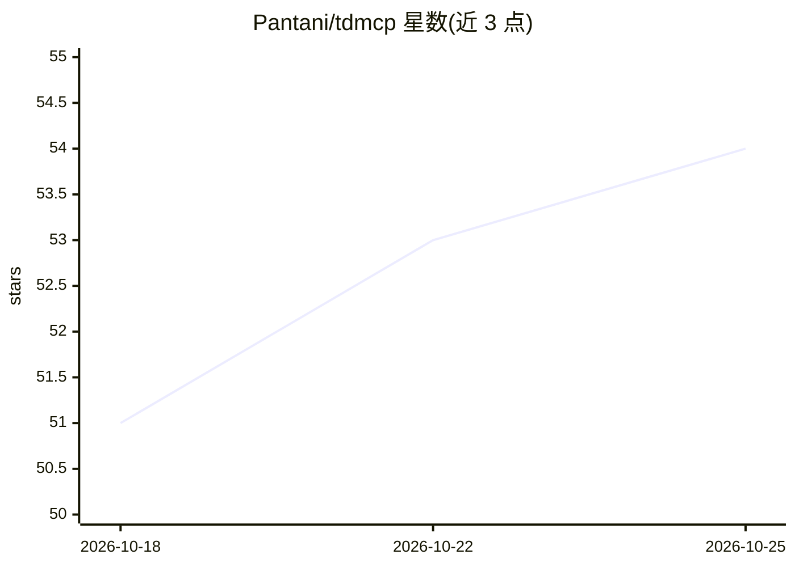

# Pantani/tdmcp

⭐ 55 · TypeScript · MIT · 推送 2026-08-15 · [GitHub](https://github.com/Pantani/tdmcp) · [官网](https://pantani.github.io/tdmcp/) · 个人维护

**TouchDesigner 的 MCP server：用自然语言让 AI 搭建可运行的节点网络**

面向 TouchDesigner 创意编码场景的 Model Context Protocol 服务器：AI 助手（Claude Desktop/Code、Cursor、Codex）根据自然语言描述在 /project1 中创建、连接、检查并预览真实节点网络。机制上分两部分——内嵌 629 个算子、68 个 Python 类等参考知识库，加上运行在 TouchDesigner 进程内的 bridge（create→verify→preview 循环），共 508 个工具。可选 Creative RAG 需本地 Ollama。bridge 会执行任意 Python 并监听 9980 端口，文档提示仅在可信网络使用。

## 筛选速览

| 维度 | 判定 | 备注 |
|---|---|---|
| AI 角色 | `ai-ecosystem` | LLM/agent 周边工具 |
| 许可风险 | `permissive` | MIT |
| 部署形态 | `library` | 以包/库形式分发 |
| 模型依赖 | local-ok | 支持本地模型 |
| 硬件要求 | — | 无带数字的原话,不猜 |
| 安装摩擦 | `low` | 无编译、无系统依赖或容器化 |
| 成熟度 | — | 结构信号不足 |

## 能力要点

- 内嵌 629 个 TouchDesigner 算子与 68 个 Python 类的知识库
- bridge 运行于 TouchDesigner 内，create→verify→preview 循环自查生成的网络
- 508 个工具，覆盖生成器、控制面板、OSC/MIDI/DMX/NDI 外部 IO 到原子节点 CRUD
- 可选本地 Creative RAG（需 Ollama，默认关闭）

## 适用场景

- 用一句话让 AI 在 TouchDesigner 里搭出音频响应或粒子视觉系统
- 通过 Claude/Cursor 迭代修改现有节点网络并预览效果
- 为生成的视觉系统挂控制面板并映射到 MIDI/OSC/DMX 控制器

## 场景标签

 · 领域:创意编码/可视化工具

## 证据(README 行号)

> L11: **tdmcp is a Model Context Protocol (MCP) server
> L60: 2. **The tdmcp server** — a small Node program that gives the AI a set of
> L61:  TouchDesigner "tools" and the operator knowledge base. You install it once.

## 星数曲线

2026-10-18 51 → 2026-10-25 54（+3）

---
*卡片 v1 · prompt 1.4 · 生成 2026-10-24 · 置信度 mid · 依据 README sha `e2d7ac96b70f` · [字段定义](../../DATASET.md)*
