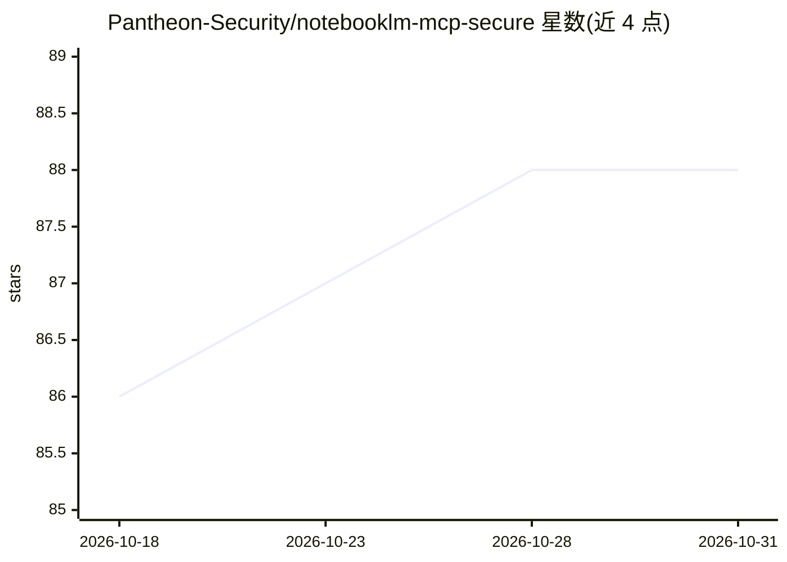

# Pantheon-Security/notebooklm-mcp-secure

⭐ 88 · TypeScript · MIT · 推送 2026-09-03 · [GitHub](https://github.com/Pantheon-Security/notebooklm-mcp-secure) · 组织维护

**安全加固的 NotebookLM MCP 服务器：让 Claude/AI agent 查询与管理笔记本**

NotebookLM MCP 服务器（PleasePrompto/notebooklm-mcp 的安全加固分支，由 Pantheon Security 维护）：通过 MCP 协议让 AI agent 查询笔记本获得基于来源的回答，并以浏览器自动化操作 NotebookLM——创建/管理笔记本、上传 PDF、生成播客式音频概览与 10 种风格的视频概览、提取结构化数据表，共 48 个工具。核心功能仅需浏览器认证，无需 API key；Gemini Deep Research 与 Document API 为可选 API 功能。包含 17 层安全机制（后量子加密、审计日志哈希链、密钥扫描），合规控制面向 GDPR/SOC2/CSSF（注明未经第三方认证）。以 npx 方式通过 Claude 等 MCP 客户端安装。

## 筛选速览

| 维度 | 判定 | 备注 |
|---|---|---|
| AI 角色 | `ai-ecosystem` | LLM/agent 周边工具 |
| 许可风险 | `permissive` | MIT |
| 部署形态 | `self-host` | docker 或自建部署 |
| 模型依赖 | — | README 未给出锁定关系 |
| 硬件要求 | — | 无带数字的原话,不猜 |
| 安装摩擦 | `low` | 无编译、无系统依赖或容器化 |
| 成熟度 | — | 结构信号不足 |

## 能力要点

- 48 个 MCP 工具覆盖笔记本管理、音视频概览生成、数据表提取
- 核心功能仅需浏览器认证，无需 API key
- 17 层安全机制：后量子加密、审计日志哈希链、SSRF 防护
- 可选 Gemini Deep Research 与免浏览器的 Document API

## 适用场景

- 让 Claude 等 AI agent 直接查询我的 NotebookLM 笔记本获得有出处的回答
- 用 agent 程序化创建笔记本并批量上传 PDF 资料
- 为文档生成播客式音频概览或 AI 视频概览

## 场景标签

`浏览器自动化` `文档问答` · 领域:效率与自动化

## 证据(README 行号)

> L68: claude mcp add notebooklm -- npx @pan-sec/notebooklm-mcp@latest
> L28: - 🔍 **Query your NotebookLM notebooks** — source-grounded, zero-hallucination answers

## 星数曲线

2026-10-18 86 → 2026-10-31 88（+2）

---
*卡片 v1 · prompt 1.4 · 生成 2026-10-23 · 置信度 mid · 依据 README sha `5f59c6d1dfd2` · [字段定义](../../DATASET.md)*
