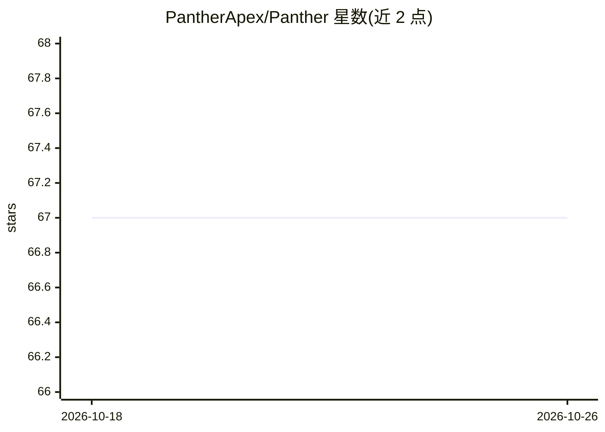

# PantherApex/Panther

⭐ 67 · Rust · MIT · 推送 2026-03-08 · [GitHub](https://github.com/PantherApex/Panther) · 个人维护

**自托管 Rust 个人 AI 代理守护进程，通过聊天应用远程操控本机**

运行在用户自己机器上的 Rust 守护进程，作为个人 AI 助手，可通过 Telegram、Discord、Slack、Email（IMAP/SMTP）、Matrix 或本地 CLI 与之对话。Agent 循环支持执行 Shell 命令、文件读写编辑、截图/摄像头/录音采集、网页搜索与抓取、cron 定时任务、子代理派生、MCP 服务器集成与自定义技能，并带活动日志与文件系统监控。可通过 Ollama 完全本地运行，或切换到 12 个云端提供商之一；切换仅是配置项变更。

## 筛选速览

| 维度 | 判定 | 备注 |
|---|---|---|
| AI 角色 | `ai-native` | 本体是模型或模型工具 |
| 许可风险 | `permissive` | MIT |
| 部署形态 | `desktop` | 安装包/桌面程序 |
| 模型依赖 | local-ok | 支持本地模型 |
| 硬件要求 | — | 无带数字的原话,不猜 |
| 安装摩擦 | `high` | 编译与系统依赖俱全 |
| 成熟度 | — | 结构信号不足 |

## 能力要点

- 6 种消息渠道（Telegram/Discord/Slack/Email/Matrix/CLI）接入同一 Agent
- Ollama 本地推理为默认提供商，另有 11 个云端提供商可切换
- 内置工具覆盖 Shell、文件系统、媒体采集、网页搜索、cron 调度、MCP 与子代理
- 活动日志支持自然语言时间表达式查询，文件系统监控自动提取文本/PDF/DOCX 内容

## 适用场景

- 通过手机上的 Telegram/Discord 等聊天软件远程指挥家里的电脑干活
- 用本地 Ollama 模型运行数据不出门的私人 AI 助手
- 让 AI 按计划定时执行命令或采集屏幕/摄像头内容

## 场景标签

`AI 助手` · 领域:对话与助手

## 证据(README 行号)

> L13: Panther is a Rust daemon that sits on your computer and acts as your personal AI assistant, reachable from any mess
> L15: It can run entirely on a local model through Ollama (zero data leaves your machine) or connect to any of twelve clo

## 星数曲线

2026-10-18 67 → 2026-10-26 67（+0）

---
*卡片 v1 · prompt 1.4 · 生成 2026-10-24 · 置信度 high · 依据 README sha `486da00bc037` · [字段定义](../../DATASET.md)*
