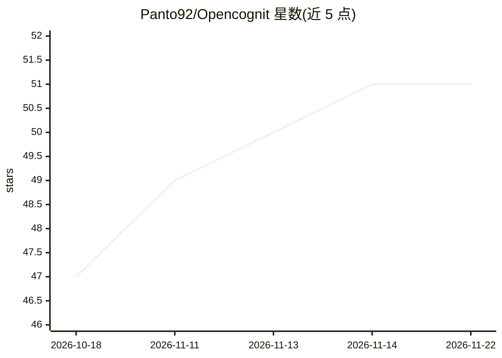

# Panto92/Opencognit

⭐ 51 · NOASSERTION · 推送 2026-11-20 · [GitHub](https://github.com/Panto92/Opencognit) · [官网](https://opencognit.com) · 组织维护

**桌面应用：在同一窗口并行编排多个编程 CLI agent**

本地运行的桌面应用，将 Claude Code、Codex、Gemini CLI、Kimi、Hermes 等编程 CLI agent 以真实 PTY 会话并列运行于网格或焦点视图。支持其中一个 agent 作为编排者向其他 agent 分发编号任务与专属文件，并设守卫机制：agent 的 shell 命令按规则拦截或询问，提交前扫描密钥，agent 不能写其文件范围之外。提供会话恢复、检查点、本地 token 用量统计；无遥测。免费版限 4 个并行会话，完整版 69 欧元一次性付费；应用本体为专有软件，旧开源平台已在 legacy 分支停止维护。

## 筛选速览

| 维度 | 判定 | 备注 |
|---|---|---|
| AI 角色 | `ai-ecosystem` | LLM/agent 周边工具 |
| 许可风险 | `none` | NOASSERTION |
| 部署形态 | `desktop` | 安装包/桌面程序 |
| 模型依赖 | — | README 未给出锁定关系 |
| 硬件要求 | — | 无带数字的原话,不猜 |
| 安装摩擦 | `low` | 无编译、无系统依赖或容器化 |
| 成熟度 | — | 结构信号不足 |

## 能力要点

- 多 CLI agent 并行 PTY 会话，每个 CLI 支持多账号隔离
- 编排者分发任务并限制各 agent 文件写入范围
- shell 命令守卫规则与提交前密钥扫描
- 会话恢复、检查点、本地 token 用量统计，无遥测

## 适用场景

- 同时运行多个编程 agent 并让一个编排其他
- 在命令执行前设置审批与密钥扫描守卫
- 查看各 agent 对文件的读写关系与每日 token 用量

## 场景标签

`多智能体` `编码 Agent` · 领域:Agent 开发

## 证据(README 行号)

> L7: Run Claude Code, Codex, Gemini CLI, Kimi and Hermes side by side, let one of them orchestrate the others, and have e
> L24: - **An orchestrator that hands out work.** One agent starts others, gives each a numbered task and its own set of f

## 星数曲线

2026-10-18 47 → 2026-11-22 51（+4）

---
*卡片 v1 · prompt 1.4 · 生成 2026-11-18 · 置信度 mid · 依据 README sha `20c8f1a9b3b9` · [字段定义](../../DATASET.md)*
