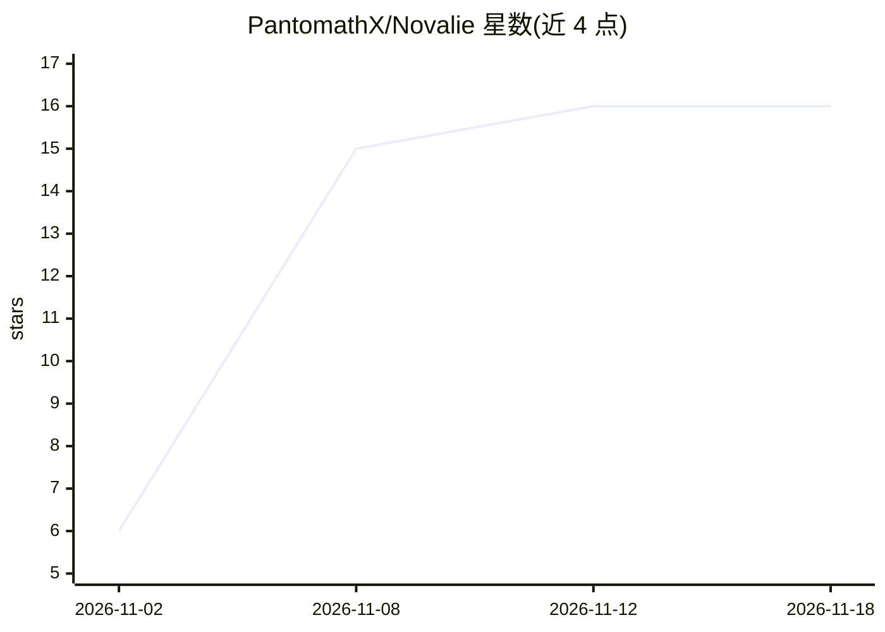

# PantomathX/Novalie

⭐ 16 · Python · 推送 2026-11-03 · [GitHub](https://github.com/PantomathX/Novalie) · 个人维护

**不被告知任何规则的通用自学习器：从符号与交互中自行发现世界规律**

纯 Python 标准库实现的通用学习程序（自称 miniature AGI 1.0）：它观察符号、选择行动，依据单一证据规则（预见的实现概率优于百万分之一）发现所处环境的规律，可为真实世界（时钟、自身状态、经用户起点链接的开放网络）或用户编写的自定义世界。带网页界面展示其规律、证据与决策；可选库扩展文件/图像/音视频读取并支持 NVIDIA GPU 加速搜索。Python 3.8+，命令行或 Windows 批处理启动。

## 筛选速览

| 维度 | 判定 | 备注 |
|---|---|---|
| AI 角色 | `ai-native` | 本体是模型或模型工具 |
| 许可风险 | `none` | — |
| 部署形态 | `library` | 以包/库形式分发 |
| 模型依赖 | — | README 未给出锁定关系 |
| 硬件要求 | — | 无带数字的原话,不猜 |
| 安装摩擦 | `low` | 无编译、无系统依赖或容器化 |
| 成熟度 | — | 结构信号不足 |

## 能力要点

- 不被告知环境规律，凭证据规则自行发现定律
- 支持自定义世界：一个含 World 类的 Python 文件即可
- 纯标准库可运行，可选依赖扩展媒体读取与 NVIDIA GPU 搜索
- 网页界面实时展示其规律、因果知识与决策依据

## 适用场景

- 在自建虚拟世界中观察通用学习器如何发现规律
- 让程序从指定链接出发自主阅读网页并学习
- 研究 anytime-valid 证据规则驱动的自学习机制

## 场景标签

 · 领域:通用机器学习/世界模型

## 证据(README 行号)

> L5: **The first miniature AGI: version 1.0.** A small general learner that is told nothing about the world it lives in.
> L6: It sees symbols, chooses acts, and finds the laws behind them by one rule of evidence: it believes a law only when
> L7: what it foresaw came true beyond one chance in a million, paying for every law it could have claimed. It lives in th

## 星数曲线

2026-11-02 6 → 2026-11-18 16（+10）

---
*卡片 v1 · prompt 1.4 · 生成 2026-11-18 · 置信度 mid · 依据 README sha `6f40715cd6c5` · [字段定义](../../DATASET.md)*
