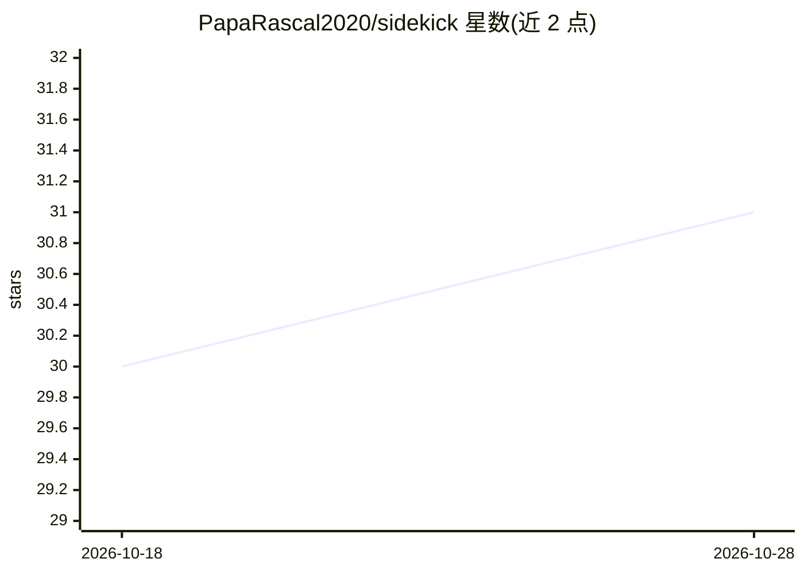

# PapaRascal2020/sidekick

⭐ 31 · PHP · GPL-3.0 · 推送 2026-08-25 · [GitHub](https://github.com/PapaRascal2020/sidekick) · [官网](https://sidekickforlaravel.com) · 个人维护

**Laravel 的多模型 AI 服务集成包，统一 API 接入四家厂商**

面向 Laravel 开发者的 PHP 包，通过 builder API 统一接入 OpenAI、Anthropic、Mistral、Cohere，提供文本生成、流式输出、工具调用、JSON Schema 结构化输出、图像生成、语音合成、语音转写、嵌入与内容审核等能力。对话记录持久化到数据库，内置 RAG 知识库系统（默认 PHP 余弦相似度检索，可换 pgvector/Pinecone 驱动）和可嵌入 Blade 模板的 Alpine.js 聊天挂件。要求 PHP 8.2+ 与 Laravel 10/11/12。Cohere 暂不支持工具调用与结构化输出。

## 筛选速览

| 维度 | 判定 | 备注 |
|---|---|---|
| AI 角色 | `ai-ecosystem` | LLM/agent 周边工具 |
| 许可风险 | `viral` | GPL-3.0 |
| 部署形态 | `None` |  |
| 模型依赖 | local-ok | 支持本地模型 |
| 硬件要求 | — | 无带数字的原话,不猜 |
| 安装摩擦 | `low` | 无编译、无系统依赖或容器化 |
| 成熟度 | — | 结构信号不足 |

## 能力要点

- 统一 builder API 覆盖四家厂商的文本/图像/音频/转录/嵌入/审核能力
- 工具调用自动循环执行（默认最多 5 轮，可配置）与手动处理两种模式
- 内置 RAG 知识库：文档摄入、向量检索、ask 一行式检索增强回答
- 数据库持久化对话与可嵌入 Blade 模板的聊天挂件

## 适用场景

- 在 Laravel 应用中用一套 API 调用多家 LLM 厂商
- 把产品 FAQ 等业务知识灌入 RAG 知识库供 AI 引用
- 在网站前台嵌入带知识库支撑的聊天挂件

## 场景标签

`RAG` `模型网关` · 领域:Agent 开发

## 证据(README 行号)

> L12: A fluent Laravel package for integrating with **OpenAI**, **Anthropic Claude**, **Mistral**, and **Cohere** AI serv
> L16: - PHP 8.2+

## 星数曲线

2026-10-18 30 → 2026-10-28 31（+1）

---
*卡片 v1 · prompt 1.4 · 生成 2026-10-26 · 置信度 high · 依据 README sha `15a8207169eb` · [字段定义](../../DATASET.md)*
