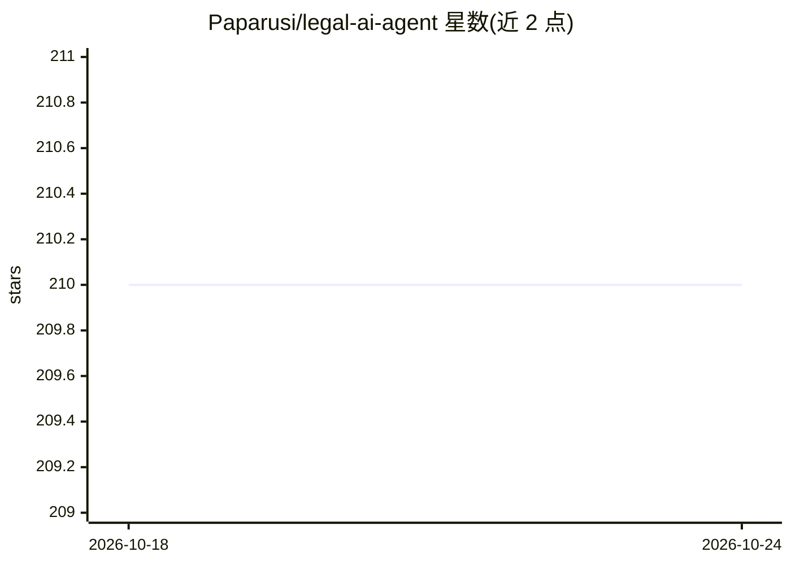

# Paparusi/legal-ai-agent

⭐ 210 · Python · MIT · 推送 2026-03-21 · [GitHub](https://github.com/Paparusi/legal-ai-agent) · 个人维护

**面向越南企业的 AI 法律助手：法律检索、合同审查与起草**

基于 FastAPI 的自托管法律 AI 平台，面向越南企业用户：AI Agent（24 个工具）可在 4 万+越南法律文档中检索，自主读写、编辑、比对、批量审查合同文档，支持 10 类风险识别、8+合同模板、条款起草与合规检查。提供 VSCode 风格三栏界面、多租户平台管理面板、成本追踪与越南法律网站爬虫（CrawlKit）。后端需 PostgreSQL（pgvector）与 Claude API key，通过 Docker 或 uvicorn 部署。

## 筛选速览

| 维度 | 判定 | 备注 |
|---|---|---|
| AI 角色 | `ai-native` | 本体是模型或模型工具 |
| 许可风险 | `permissive` | MIT |
| 部署形态 | `self-host` | docker 或自建部署 |
| 模型依赖 | locked-api |  |
| 硬件要求 | — | 无带数字的原话,不猜 |
| 安装摩擦 | `low` | 无编译、无系统依赖或容器化 |
| 成熟度 | — | 结构信号不足 |

## 能力要点

- 24 工具 AI Agent，可自主读写/编辑/比对/批量审查文档
- 检索 40,000+ 越南法律文档，10 类风险分析
- 多租户平台管理与 LLM 成本追踪面板
- CrawlKit 驱动的越南法律网站爬虫
- 提供 Docker 部署（含 PostgreSQL 15 + pgvector）

## 适用场景

- 越南企业上传合同进行 AI 风险审查与合规检查
- 让 AI 依据越南法律起草条款或整份合同
- 在自有服务器/NAS 上自托管法律文档管理平台

## 场景标签

`RAG` `文档问答` · 领域:知识与检索

## 证据(README 行号)

> L14: An AI platform for legal research, contract review, and legal document drafting — all in a VSCode-style interface.
> L39: ### 🤖 AI Agent (24 Tools)
> L41: - **Contract review** — Risk analysis, missing clauses, amendment suggestions

## 星数曲线

2026-10-18 210 → 2026-10-24 210（+0）

---
*卡片 v1 · prompt 1.4 · 生成 2026-10-22 · 置信度 high · 依据 README sha `5c142e29b2af` · [字段定义](../../DATASET.md)*
