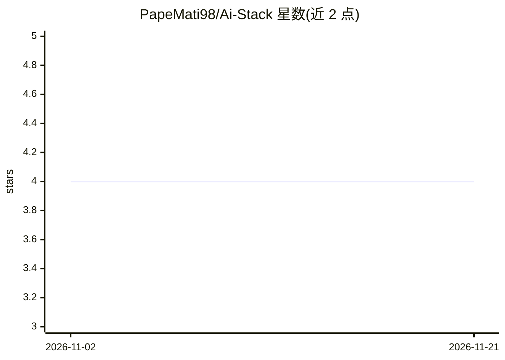

# PapeMati98/Ai-Stack

⭐ 4 · Python · Apache-2.0 · 推送 2026-11-03 · [GitHub](https://github.com/PapeMati98/Ai-Stack) · [官网](https://synaptivo.eu) · 组织维护

**多模型 agent 编排栈：一个模型构建、不同系谱模型评审**

将用户已订阅的多个编码 CLI（Claude Code、Codex、Gemini、Grok、Kimi 等）以无头方式驱动为一个团队：默认任务由不同模型家族组成 maker/reviewer 对，评审未通过触发定向修复；支持任务依赖图并行、本地持久化 agent 消息总线（Agent Office）与共享知识库（Knowledge Hub），附带 60+ 个 SKILL.md 技能。完整栈 Windows 优先、由单人操作者测试；仓库为工程发布版，不含模型权重、CLI 二进制与任何账户凭据。

## 筛选速览

| 维度 | 判定 | 备注 |
|---|---|---|
| AI 角色 | `ai-ecosystem` | LLM/agent 周边工具 |
| 许可风险 | `permissive` | Apache-2.0 |
| 部署形态 | `None` |  |
| 模型依赖 | — | README 未给出锁定关系 |
| 硬件要求 | — | 无带数字的原话,不猜 |
| 安装摩擦 | `low` | 无编译、无系统依赖或容器化 |
| 成熟度 | `idea` | |

## 能力要点

- 默认跨模型系谱评审：Claude 构建、Gemini/Grok 评审，失败触发定向修复
- Fleet 用用户自有订阅驱动官方 CLI，校验实际应答模型且不静默回退按量计费
- 任务依赖图支持并行分支与每节点独立评审
- Agent Office 消息总线与 Knowledge Hub 溯源知识库

## 适用场景

- 让已付费的多个编码 CLI 协作完成有依赖关系的并行任务
- 用不同模型家族互相评审代码产出
- 为多个 agent 建立共享项目知识与消息交接机制

## 场景标签

`多智能体` `编码 Agent` `代码审查` · 领域:Agent 开发

## 证据(README 行号)

> L5: A multi-model agent stack that runs the coding CLIs you already pay for —
> L26: - **Your subscriptions, not surprise API bills.** The native Fleet drives the
> L68: AI Stack combines reusable skills, native CLI execution, a dependency scheduler,

## 星数曲线

2026-11-02 4 → 2026-11-21 4（+0）

---
*卡片 v1 · prompt 1.4 · 生成 2026-11-21 · 置信度 high · 依据 README sha `e3c81adca70f` · [字段定义](../../DATASET.md)*
