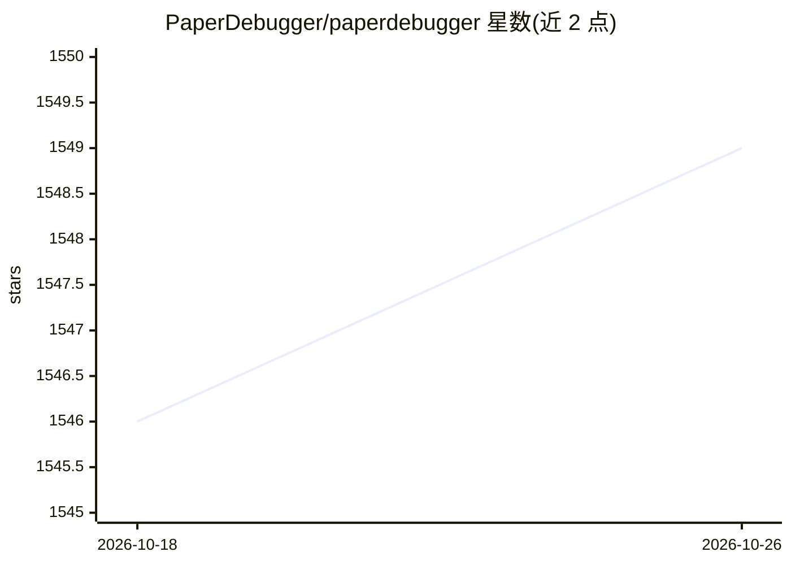

# PaperDebugger/paperdebugger

⭐ 1,549 · TypeScript · AGPL-3.0 · 推送 2026-07-03 · [GitHub](https://github.com/PaperDebugger/paperdebugger) · [官网](https://www.paperdebugger.com/) · 组织维护

**给科研人员的 Overleaf 论文写作 AI 助手（Chrome 扩展）**

Chrome 浏览器扩展形态的学术论文写作助手：在 Overleaf 编辑器内提供 AI 对话、一键插入回答、自动生成评论、提示词模板等功能，只读取项目内容不做修改。核心机制为自研 MCP 编排引擎，模拟 Research→Critique→Revision 学术流程，支持文献检索、AI 会议式审稿、引用核验与领域修订。后端为 Go 微服务（Gin + gRPC + MongoDB），集成 OpenAI API，支持自托管后端与自定义端点配置。

## 筛选速览

| 维度 | 判定 | 备注 |
|---|---|---|
| AI 角色 | `ai-native` | 本体是模型或模型工具 |
| 许可风险 | `viral` | AGPL-3.0 |
| 部署形态 | `None` |  |
| 模型依赖 | — | README 未给出锁定关系 |
| 硬件要求 | — | 无带数字的原话,不猜 |
| 安装摩擦 | `low` | 无编译、无系统依赖或容器化 |
| 成熟度 | — | 结构信号不足 |

## 能力要点

- 在 Overleaf 编辑器内提供 AI 对话与建议，只读不改项目
- MCP 编排引擎模拟 Research→Critique→Revision 多步工作流
- 支持一键插入 AI 回答与自动生成评论
- 支持自托管后端与自定义端点配置

## 适用场景

- 写论文时在 Overleaf 内直接向 AI 提问获取修改建议
- 模拟审稿人视角对论文草稿做批评与修订
- 核验引用与文献支撑情况

## 场景标签

`AI 写作` `科研工具` · 领域:内容生成

## 证据(README 行号)

> L9: **PaperDebugger** is an AI-powered academic writing assistant that helps researchers debug and improve their researc
> L22: - **🤖 AI-Powered Chat**: Intelligent conversations about your Overleaf project

## 星数曲线

2026-10-18 1,546 → 2026-10-26 1,549（+3）

---
*卡片 v1 · prompt 1.4 · 生成 2026-10-21 · 置信度 high · 依据 README sha `f18ee44089c4` · [字段定义](../../DATASET.md)*
