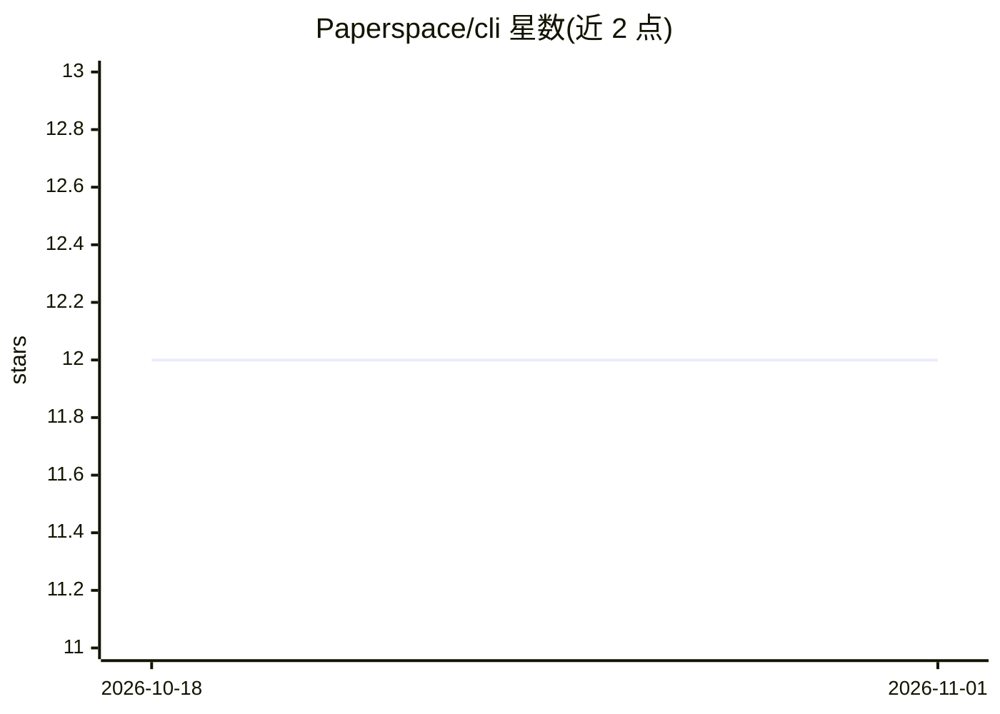

# Paperspace/cli

⭐ 12 · TypeScript · Apache-2.0 · 推送 2026-02-07 · [GitHub](https://github.com/Paperspace/cli) · [官网](https://docs-next.paperspace.com/cli/overview) · 组织维护

**Paperspace 云平台的官方命令行工具**

Paperspace 官方 CLI：通过终端命令 pspace [command] [flags] 管理和操作 Paperspace 云平台资源。安装方式为 Shell 脚本一键安装（curl 管道执行 install.sh），支持 macOS、Linux 及 Windows（经 WSL）。README 未列出具体命令集，详细用法指向官方文档。作为云 GPU 平台的工具，面向使用 Paperspace 进行 GPU 计算、机器学习开发的用户。

## 筛选速览

| 维度 | 判定 | 备注 |
|---|---|---|
| AI 角色 | `ai-ecosystem` | LLM/agent 周边工具 |
| 许可风险 | `permissive` | Apache-2.0 |
| 部署形态 | `None` |  |
| 模型依赖 | — | README 未给出锁定关系 |
| 硬件要求 | — | 无带数字的原话,不猜 |
| 安装摩擦 | `low` | 无编译、无系统依赖或容器化 |
| 成熟度 | — | 结构信号不足 |

## 能力要点

- pspace 命令行工具，终端操作 Paperspace 平台
- Shell 脚本一键安装（macOS/Linux/WSL）

## 适用场景

- 在终端中管理 Paperspace 云 GPU 实例等资源
- 脚本化操作 Paperspace 平台

## 场景标签

 · 领域:云计算/GPU 平台工具

## 证据(README 行号)

> L1: # Paperspace CLI
> L22: Paperspace CLI documentation.

## 星数曲线

2026-10-18 12 → 2026-11-01 12（+0）

---
*卡片 v1 · prompt 1.4 · 生成 2026-11-01 · 置信度 mid · 依据 README sha `44659a39a799` · [字段定义](../../DATASET.md)*
