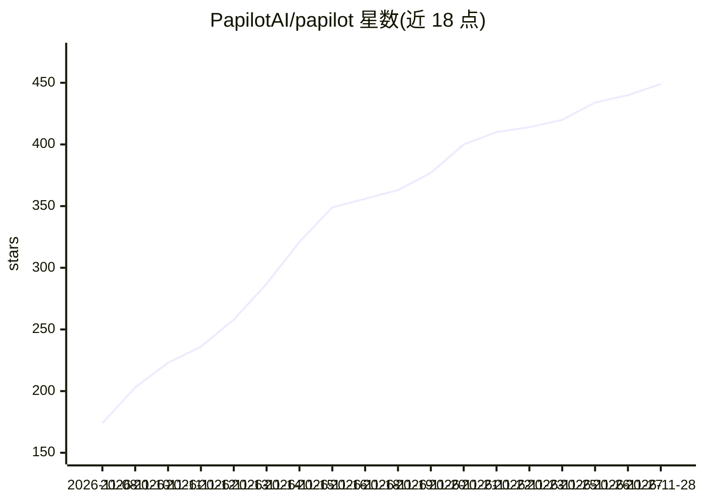

# PapilotAI/papilot

⭐ 449 · TypeScript · MIT · 推送 2026-11-27 · [GitHub](https://github.com/PapilotAI/papilot) · [官网](https://papilot.ai) · 组织维护

**面向论文作者的 AI LaTeX 编辑器：在 PDF 上标注并审阅 agent 改动**

基于 Electron 的 LaTeX 编辑器，用户不直接读写 .tex，而是在 PDF 上圈选句子、公式或图并附注修改要求，连接的 agent 据此编辑源文件；每处修改以排版后的前后对照呈现于 PDF，经 Accept/Reject/Comment 流程确认。每个任务在独立 Git worktree 中运行，提交与推送是独立步骤。支持与 Overleaf 双向实时同步，可从手机/平板通过 Tailscale 审阅，并提供论文、期刊、会议、海报等模板库 Papilot Universe。需 Git、TeX 发行版与已登录的 agent。

## 筛选速览

| 维度 | 判定 | 备注 |
|---|---|---|
| AI 角色 | `ai-enhanced` | 去掉 AI 部分产品仍成立 |
| 许可风险 | `permissive` | MIT |
| 部署形态 | `desktop` | 安装包/桌面程序 |
| 模型依赖 | — | README 未给出锁定关系 |
| 硬件要求 | — | 无带数字的原话,不猜 |
| 安装摩擦 | `low` | 无编译、无系统依赖或容器化 |
| 成熟度 | — | 结构信号不足 |

## 能力要点

- PDF 圈选标注作为 agent 指令，改动以排版前后对照审阅
- 与 Overleaf 双向实时同步，改动约一秒送达合作者
- 每任务独立 Git worktree，接受后单独提交入历史
- 支持 Codex、Claude、Cursor、Copilot 等多个 agent 与模型切换

## 适用场景

- 在 PDF 上批注让 agent 修改论文并逐条审阅接受
- 与合作者在 Overleaf 协作的同时用 agent 编辑
- 从 400+ 会议模板库创建可直接编译的论文工程

## 场景标签

`编码 Agent` `AI 写作` · 领域:编码与开发

## 证据(README 行号)

> L1: PapilotPapilot **Next-Generation AI LaTeX Editor**
> L27: Select a sentence, or box an equation or a figure, and write what should change. Your agent gets the exact source l
> L123:  Papilot Writer, Codex, Claude, Cursor, GitHub Copilot, Grok, Antigravity, Kimi, GLM, ZCode, DeepSeek, Qwen, OpenC

## 星数曲线

2026-11-08 174 → 2026-11-28 449（+275）

---
*卡片 v1 · prompt 1.4 · 生成 2026-11-28 · 置信度 high · 依据 README sha `20862e7d3440` · [字段定义](../../DATASET.md)*
