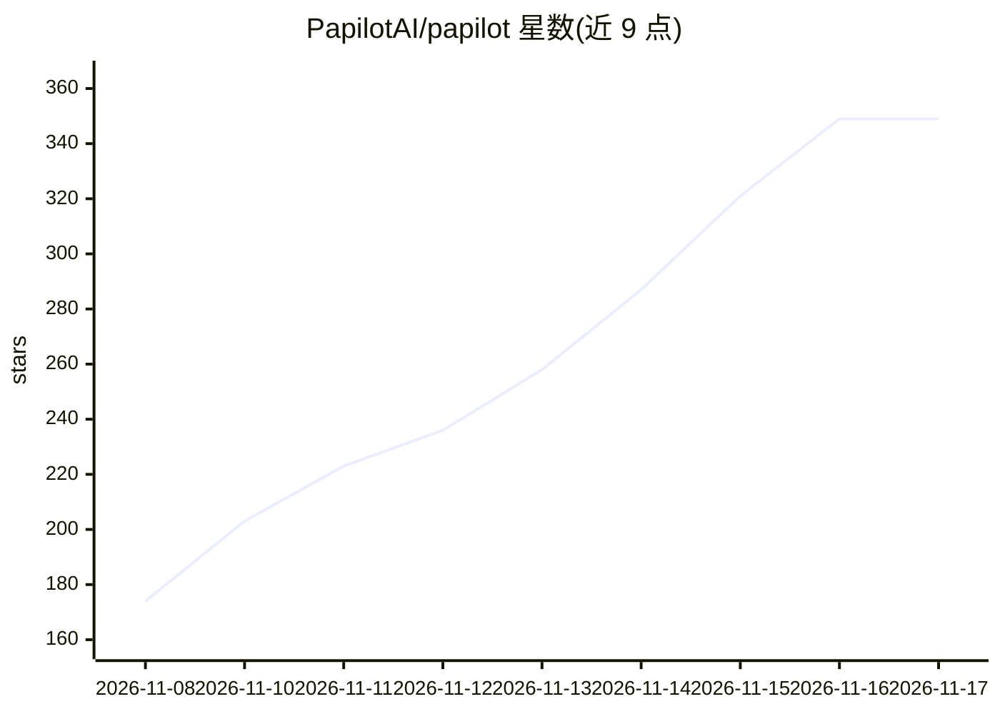

# PapilotAI/papilot

⭐ 349 · TypeScript · MIT · 推送 2026-11-16 · [GitHub](https://github.com/PapilotAI/papilot) · [官网](https://papilot.ai) · 组织维护 · 中文 README

**面向 PDF 的 AI LaTeX 编辑器：直接在排版页面上标注修改**

跨平台（macOS/Linux/Windows）开源 LaTeX 编辑器：用户在编译后的 PDF 页面上框选句子、公式或图片并写指令，由外部 AI agent 定位并修改 .tex 源码，编辑结果以排版前后的对照 PDF 呈现，可接受、拒绝或评论。项目文件保持为本地普通文件，变更进入 Git 历史，可与合作者通过 Git 同步。支持接入 Claude、Codex、Cursor、Copilot、Grok、Kimi、GLM、DeepSeek、Qwen 等多种 agent。提供桌面安装包与 npm CLI 两种分发方式，运行需另装 Git 和 TeX Live/MacTeX。

## 筛选速览

| 维度 | 判定 | 备注 |
|---|---|---|
| AI 角色 | `ai-enhanced` | 去掉 AI 部分产品仍成立 |
| 许可风险 | `permissive` | MIT |
| 部署形态 | `desktop` | 安装包/桌面程序 |
| 模型依赖 | — | README 未给出锁定关系 |
| 硬件要求 | — | 无带数字的原话,不猜 |
| 安装摩擦 | `low` | 无编译、无系统依赖或容器化 |
| 成熟度 | — | 结构信号不足 |

## 能力要点

- 在 PDF 页面上直接标注目标（句子/公式/图），agent 查找并修改 .tex 源码
- AI 编辑以排版前后的 PDF 对照展示，支持 Accept/Reject/Comment
- 文件保持本地普通文件，变更落入 Git 历史，支持 agent 解决合并冲突
- 可接入多种已有 AI agent（Claude、Codex、Cursor、Copilot、Kimi、Qwen 等）

## 适用场景

- 写论文/学位论文时直接在成品页面上提出修改，不手写 LaTeX
- 审查 AI 对 LaTeX 源码的改动，直接看排版效果而非源码 diff
- 与合作者通过 Git 协作维护 LaTeX 项目

## 场景标签

`AI 写作` `代码审查` · 领域:编码与开发

## 证据(README 行号)

> L17:  Papilot shows an AI edit as a typeset before-and-after on the PDF, with Accept, Reject and Comment.
> L33: Mark a sentence, an equation or a figure, and write a note.
> L44:  &nbsp;**Free and open source.** MIT licensed, for macOS, Linux and Windows.

## 星数曲线

2026-11-08 174 → 2026-11-17 349（+175）

---
*卡片 v1 · prompt 1.4 · 生成 2026-11-17 · 置信度 high · 依据 README sha `ed923735b365` · [字段定义](../../DATASET.md)*
