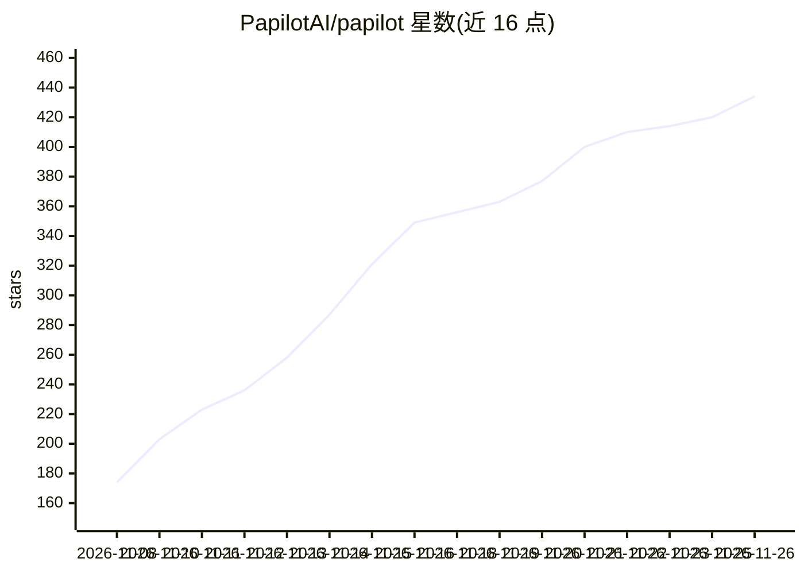

# PapilotAI/papilot

⭐ 434 · TypeScript · MIT · 推送 2026-11-25 · [GitHub](https://github.com/PapilotAI/papilot) · [官网](https://papilot.ai) · 组织维护 · 中文 README

**面向科研作者的 AI LaTeX 编辑器：在 PDF 上批注并审阅 AI 修改**

Papilot 是一款 Electron 桌面 LaTeX 编辑器：用户直接在 PDF 上圈选句子、公式或图并写批注，编辑器将对应源码行交给接入的 agent，修改以排版后的 before/after 形式回到 PDF 上，经 Accept/Reject/Comment 后才写入论文。支持与 Overleaf 双向实时同步（约一秒送达）、每个任务在独立 Git worktree 运行、提交记录进 Git 历史、手机/平板远程审阅，以及含 400+ 会议模板的 Papilot Universe。需要 Git、TeX 发行版和一个已登录的 agent。

## 筛选速览

| 维度 | 判定 | 备注 |
|---|---|---|
| AI 角色 | `ai-native` | 本体是模型或模型工具 |
| 许可风险 | `permissive` | MIT |
| 部署形态 | `desktop` | 安装包/桌面程序 |
| 模型依赖 | — | README 未给出锁定关系 |
| 硬件要求 | — | 无带数字的原话,不猜 |
| 安装摩擦 | `low` | 无编译、无系统依赖或容器化 |
| 成熟度 | — | 结构信号不足 |

## 能力要点

- 在 PDF 上圈选批注，agent 获取精确源码行
- 每处修改以排版前后对照呈现，接受前不进入论文
- 与 Overleaf 双向实时同步，保留合作者署名
- 每个任务独立 Git worktree，变更记录进 Git 历史

## 适用场景

- 与 Overleaf 合作者并行写作时让 agent 修改论文并逐条审阅
- 在 PDF 上直接圈点公式、图和句子提出修改意见
- 从论文、期刊、会议模板库快速创建新论文项目
- 通过手机或平板远程审阅并接受论文修改

## 场景标签

`科研工具` · 领域:学习与行业

## 证据(README 行号)

> L1: PapilotPapilot **Next-Generation AI LaTeX Editor**
> L27: Select a sentence, or box an equation or a figure, and write what should change. Your agent gets the exact source l
> L66:  Papilot Writer, Codex, Claude, Cursor, GitHub Copilot, Grok, Antigravity, Kimi, GLM, DeepSeek, Qwen, OpenCode, Qod

## 星数曲线

2026-11-08 174 → 2026-11-26 434（+260）

---
*卡片 v1 · prompt 1.4 · 生成 2026-11-25 · 置信度 high · 依据 README sha `2ae575a117f0` · [字段定义](../../DATASET.md)*
