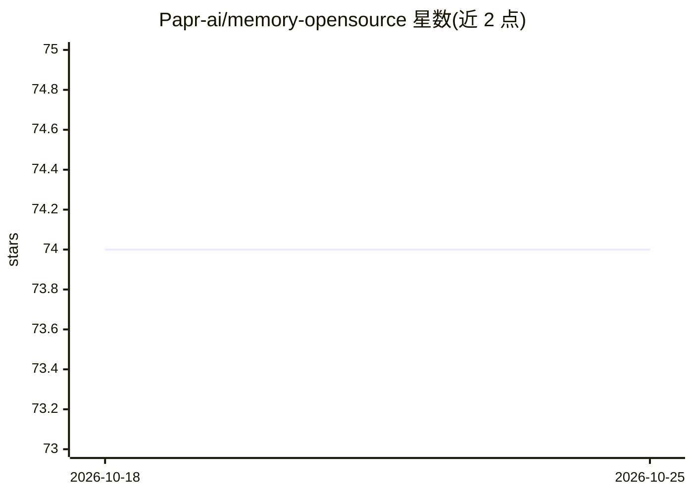

# Papr-ai/memory-opensource

⭐ 74 · Python · AGPL-3.0 · 推送 2026-04-16 · [GitHub](https://github.com/Papr-ai/memory-opensource) · [官网](https://papr.ai) · 组织维护

**面向 AI agent 的预测性记忆层，存储/检索/关联记忆**

为 AI agent 提供长期记忆存储与检索的自托管服务：组合 MongoDB（文档存储）、Neo4j（记忆关系图）、Qdrant（向量语义搜索）与 Redis（缓存），通过 FastAPI 暴露 REST API，支持自定义 schema 与 GraphQL。默认使用 Qwen3-Embedding-0.6B 本地嵌入模型（隐私优先），也可切换 DeepInfra 等云端嵌入。提供 Docker Compose 一键部署与手动 Python 部署两种方式；开源版标注部分功能（如托管基础设施、企业 SSO）仅限云版本。

## 筛选速览

| 维度 | 判定 | 备注 |
|---|---|---|
| AI 角色 | `ai-ecosystem` | LLM/agent 周边工具 |
| 许可风险 | `viral` | AGPL-3.0 |
| 部署形态 | `self-host` | docker 或自建部署 |
| 模型依赖 | — | README 未给出锁定关系 |
| 硬件要求 | — | 无带数字的原话,不猜 |
| 安装摩擦 | `low` | 无编译、无系统依赖或容器化 |
| 成熟度 | — | 结构信号不足 |

## 能力要点

- MongoDB + Qdrant + Neo4j + Redis 组合的记忆存储与语义搜索
- 默认本地运行 Qwen3-Embedding-0.6B 嵌入模型，无需外部 API 调用
- Docker Compose 一键部署，首次启动自动初始化 schema 与测试凭证
- FastAPI REST API，含约 119 个 V1 端点测试

## 适用场景

- 为客服语音 agent 或 B2B agent 提供持久化记忆
- 编码 agent 用自定义 ontology + GraphQL 检索代码库上下文
- 金融/医疗等场景下自托管、数据不出本地的 agent 记忆管理

## 场景标签

`Agent 记忆` · 领域:Agent 开发

## 证据(README 行号)

> L11: Papr Memory is the predictive memory layer for your AI agents that allows you to:
> L65: - **FastAPI Server**: Main API layer with authentication and routing
> L69: - **Qdrant**: Vector database for semantic search and embeddings

## 星数曲线

2026-10-18 74 → 2026-10-25 74（+0）

---
*卡片 v1 · prompt 1.4 · 生成 2026-10-24 · 置信度 mid · 依据 README sha `d35f53c5dbad` · [字段定义](../../DATASET.md)*
