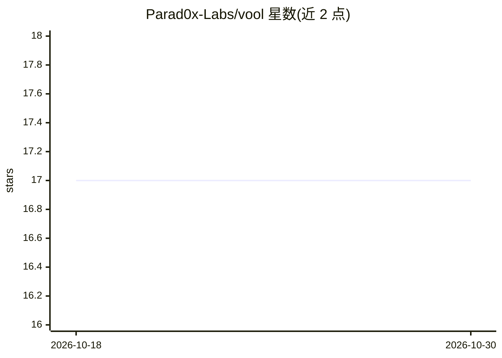

# Parad0x-Labs/vool

⭐ 17 · Python · MIT · 推送 2026-10-29 · [GitHub](https://github.com/Parad0x-Labs/vool) · [官网](https://vool.dev) · 组织维护

**本地优先的个人 agent 运行时：本地模型执行任务并留存记忆**

Parad0x Labs 开发的桌面端个人 agent 应用：连接本地 LLM（通过 Ollama 等本地运行时），可读代码库、编辑文件、运行测试、做网页研究；提供跨会话的本地记忆与检索、工具活动记录、可离线验证的签名回执，以及工作区权限与审批控制。安装时按硬件选择本地模型档位，云模型为可选接入。当前 0.7.5-beta，提供 macOS（Apple Silicon/Intel）与 Linux 安装包，Windows 仅源码实验路径；Intel Mac 本地模型限 CPU 运行。

## 筛选速览

| 维度 | 判定 | 备注 |
|---|---|---|
| AI 角色 | `ai-native` | 本体是模型或模型工具 |
| 许可风险 | `permissive` | MIT |
| 部署形态 | `desktop` | 安装包/桌面程序 |
| 模型依赖 | local-ok | 支持本地模型 |
| 硬件要求 | — | 无带数字的原话,不猜 |
| 安装摩擦 | `low` | 无编译、无系统依赖或容器化 |
| 成熟度 | `idea` | |

## 能力要点

- 本地 LLM 默认运行，无需账户或云 API key
- 跨会话本地记忆、上下文管理与检索，附 LoCoMo 基准结果
- 签名 honesty receipts 提供可离线验证的防篡改操作记录
- 工作区范围、操作模式与敏感操作权限检查，支持插件与 MCP

## 适用场景

- 让 agent 在本地模型上读代码、修 bug、跑测试
- 跨会话保留项目决策与上下文，下次继续
- 研究网页资料并保存带引用的结果

## 场景标签

`AI 助手` `编码 Agent` · 领域:编码与开发

## 证据(README 行号)

> L11: **VOOL is a local-first personal agent from Parad0x Labs.** It connects conversation to action: read a project, edi
> L13: Start with a local model and no VOOL account or cloud API key. Connect your own cloud provider when you want more m
> L29: Run local inference through Ollama or supported local runtimes, or connect a cloud model with your own credentials.

## 星数曲线

2026-10-18 17 → 2026-10-30 17（+0）

---
*卡片 v1 · prompt 1.4 · 生成 2026-10-30 · 置信度 high · 依据 README sha `d7b43acac24e` · [字段定义](../../DATASET.md)*
