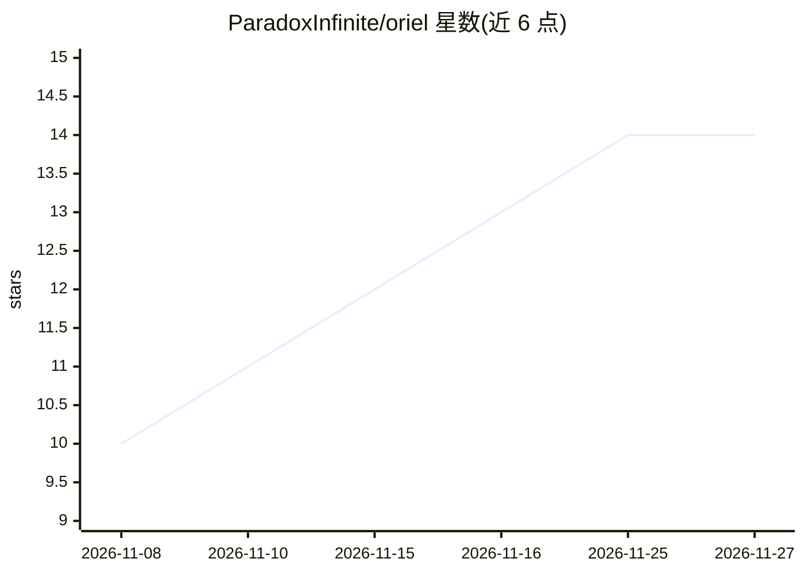

# ParadoxInfinite/oriel

⭐ 14 · Go · Apache-2.0 · 推送 2026-09-07 · [GitHub](https://github.com/ParadoxInfinite/oriel) · [官网](https://paradoxinfinite.github.io/oriel/) · 个人维护

**给开发者的本地 Docker/Colima 浏览器 GUI，兼作 MCP 服务器**

单二进制（约 13 MB）的本地容器管理工具：浏览器 UI 覆盖容器、镜像、卷、网络与 Compose 管理，支持容器内终端、CPU/内存仪表盘与命令面板。同时以 `oriel mcp` 运行为 MCP 服务器，任意 MCP 客户端（Claude、Cursor、本地 LLM）调用与 UI 相同的工具集；内置密钥脱敏、破坏性操作授权窗口（time-boxed grant）与审计日志。二进制内不含模型，依赖任意 Docker 兼容引擎与 docker CLI，支持 macOS 与 Linux。

## 筛选速览

| 维度 | 判定 | 备注 |
|---|---|---|
| AI 角色 | `ai-enhanced` | 去掉 AI 部分产品仍成立 |
| 许可风险 | `permissive` | Apache-2.0 |
| 部署形态 | `library` | 以包/库形式分发 |
| 模型依赖 | — | README 未给出锁定关系 |
| 硬件要求 | — | 无带数字的原话,不猜 |
| 安装摩擦 | `low` | 无编译、无系统依赖或容器化 |
| 成熟度 | — | 结构信号不足 |

## 能力要点

- 浏览器 UI 管理容器/镜像/卷/网络/Compose，含容器内交互终端
- MCP 服务器模式：任意 MCP 客户端驱动与 UI 相同的校验工具
- 密钥脱敏、破坏性操作授权窗口与工具调用审计日志
- 多引擎支持：Colima（一等支持）、Docker Engine、OrbStack、Podman、远程 daemon

## 适用场景

- 在浏览器里管理 macOS/Linux 上的 Colima 或 Docker 容器
- 让 Claude/Cursor 等客户端用自然语言查询与操作容器
- 需要密钥脱敏与破坏性操作门控的 AI 容器运维

## 场景标签

 · 领域:开发运维工具/容器管理

## 证据(README 行号)

> L7: Manage containers, images, volumes, networks, and Compose from a clean browser UI. Or hand the job to an AI: any MCP
> L72: Needs any Docker Engine–compatible runtime + the `docker` CLI. Colima is first-class (adds VM start/stop); Docker E
> L106: `oriel mcp` runs Oriel as a Model Context Protocol server, so an MCP client (Claude Desktop, Claude Code, Cursor, 

## 星数曲线

2026-11-08 10 → 2026-11-27 14（+4）

---
*卡片 v1 · prompt 1.4 · 生成 2026-11-18 · 置信度 high · 依据 README sha `e7cc7f622b1f` · [字段定义](../../DATASET.md)*
