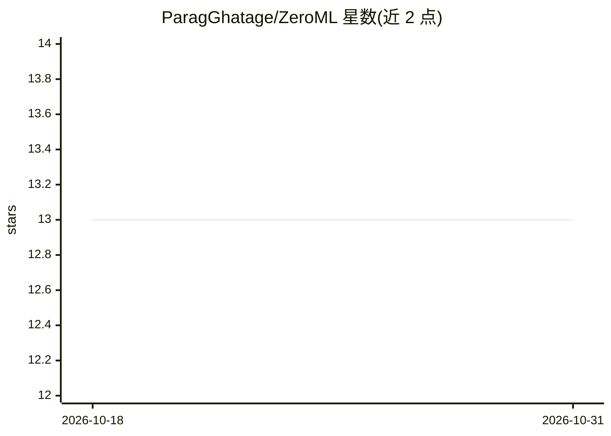

# ParagGhatage/ZeroML

⭐ 13 · TypeScript · Apache-2.0 · 推送 2026-06-07 · [GitHub](https://github.com/ParagGhatage/ZeroML) · [官网](https://zeroml.dev) · 个人维护

**可视化端到端机器学习平台：构建、训练、微调与部署模型**

面向开发者的可视化优先 ML 平台，提供拖拽式端到端流水线构建、模型训练与微调、prompt 驱动的数据清洗与特征工程、超参调优、训练可视化，以及数据集/模型/流水线的全量版本管理。采用混合部署策略：小模型本地或 Hugging Face 训练并部署到 HF Endpoints，大模型在 RunPod 训练与部署，资产统一托管于 Hugging Face Hub。支持插件系统扩展数据处理、模型与部署后端。README 仅给出前后端源码运行方式（npm/uv），文档标注'即将推出'，尚无完整使用文档。

## 筛选速览

| 维度 | 判定 | 备注 |
|---|---|---|
| AI 角色 | `ai-ecosystem` | LLM/agent 周边工具 |
| 许可风险 | `permissive` | Apache-2.0 |
| 部署形态 | `library` | 以包/库形式分发 |
| 模型依赖 | — | README 未给出锁定关系 |
| 硬件要求 | — | 无带数字的原话,不猜 |
| 安装摩擦 | `low` | 无编译、无系统依赖或容器化 |
| 成熟度 | — | 结构信号不足 |

## 能力要点

- 拖拽式端到端 ML 流水线构建
- 混合部署：HF Endpoints / RunPod / 自有服务器
- 数据集、模型、流水线全量版本化
- 插件系统支持自定义数据处理、模型与部署后端

## 适用场景

- 用可视化界面构建和训练机器学习流水线
- 小模型走 Hugging Face、大模型走 RunPod 的混合部署
- 对数据集与模型做版本管理以便复现与协作

## 场景标签

`微调` `模型训练` `MLOps` · 领域:训练与推理

## 证据(README 行号)

> L15: ZeroML is a **visual-first, fully extensible ML platform** that lets you:
> L17: * Build end-to-end ML pipelines with **drag-and-drop ease**
> L43: * Deploy anywhere: **HF Endpoints**, **RunPod**, or your own server

## 星数曲线

2026-10-18 13 → 2026-10-31 13（+0）

---
*卡片 v1 · prompt 1.4 · 生成 2026-10-31 · 置信度 mid · 依据 README sha `ce4c42eb79f6` · [字段定义](../../DATASET.md)*
