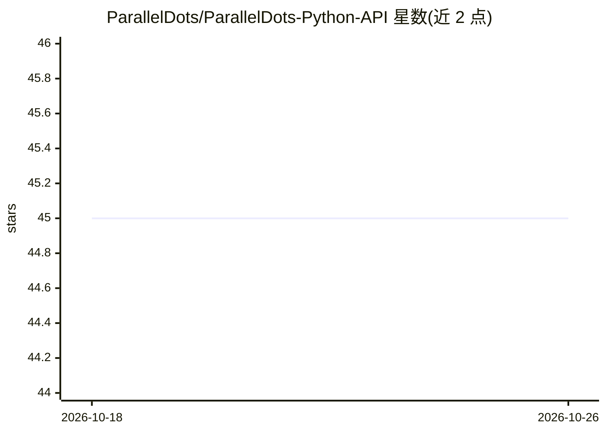

# ParallelDots/ParallelDots-Python-API

⭐ 45 · Python · 推送 2026-01-19 · [GitHub](https://github.com/ParallelDots/ParallelDots-Python-API) · 组织维护

**ParallelDots AI API 的 Python 封装客户端**

ParallelDots 云端 NLP 与图像分析 API 的 Python 封装库：注册账号获取 API key 后，通过 set_api_key 配置，即可调用情感分析、情绪、讽刺检测、辱骂检测、意图、关键词、NER、短语抽取、语义相似度、文本分类等文本接口，以及面部情绪、物体识别、NSFW 与人气图片分类等图像接口；多数接口提供批量版本，文本类接口支持包括简体中文在内的 13 种语言。安装方式为 PyPI pip 或源码 setup.py。

## 筛选速览

| 维度 | 判定 | 备注 |
|---|---|---|
| AI 角色 | `ai-ecosystem` | LLM/agent 周边工具 |
| 许可风险 | `none` | — |
| 部署形态 | `library` | 以包/库形式分发 |
| 模型依赖 | — | README 未给出锁定关系 |
| 硬件要求 | — | 无带数字的原话,不猜 |
| 安装摩擦 | `low` | 无编译、无系统依赖或容器化 |
| 成熟度 | — | 结构信号不足 |

## 能力要点

- 覆盖 18 类 ParallelDots API（文本 NLP 与图像分析）
- 多数接口提供批量调用版本
- 文本接口支持 13 种语言（含简体中文，多语关键词接口除外）
- 支持本地路径与 URL 两种图片输入方式

## 适用场景

- 在 Python 项目中调用 ParallelDots 做情感与情绪分析
- 对文本做命名实体识别、关键词与短语抽取
- 对面部图片或 URL 做情绪与物体识别

## 场景标签

 · 领域:NLP/计算机视觉 API 客户端

## 证据(README 行号)

> L3: A wrapper for the ParallelDots APIs.
> L48: Supported APIs:

## 星数曲线

2026-10-18 45 → 2026-10-26 45（+0）

---
*卡片 v1 · prompt 1.4 · 生成 2026-10-25 · 置信度 high · 依据 README sha `c44353b16e3a` · [字段定义](../../DATASET.md)*
