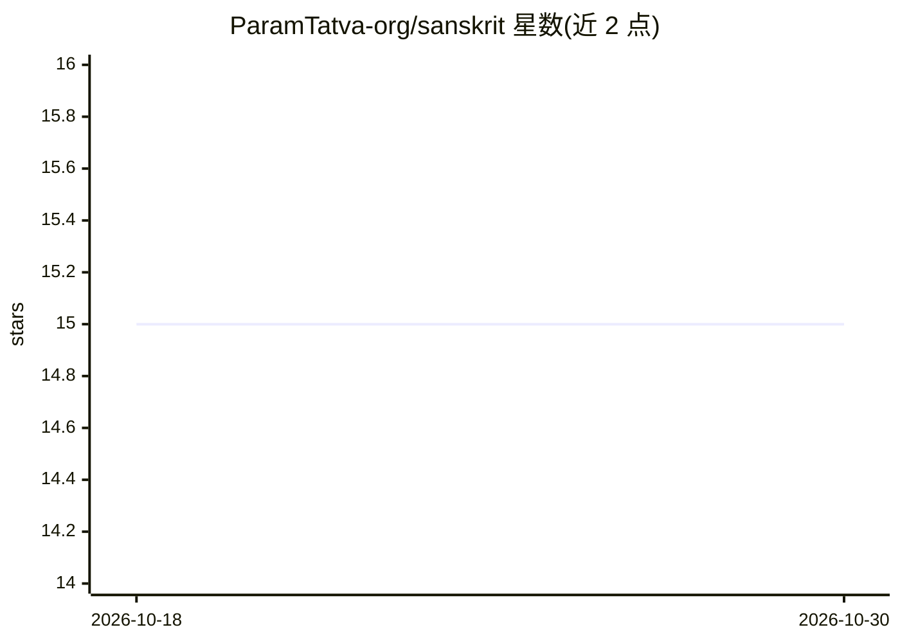

# ParamTatva-org/sanskrit

⭐ 15 · Python · 推送 2025-12-09 · [GitHub](https://github.com/ParamTatva-org/sanskrit) · [官网](https://mantr.net) · 组织维护

**面向梵语原生输入的 62M 参数开源多模态基础模型及权重**

发布 Nalanda-62M-Multi（6200 万参数，多模态 transformer）与 Govardhan（100 万参数）两个梵语原生 LLM 的权重与推理引擎，仓库内提供模型检查点（./weights/nalanda-62m-multi）和含 CPU/GPU 及量化支持的推理二进制（./engine/）。自称基于梵语屈折语法获得约 1.8:1 的 Token 压缩比，训练细节见仓库内 संस्कृत.md 预印本（2025）。以 git clone 源码方式运行，兼容 HuggingFace Transformers 与 ONNX，支持文本推理、图像描述/VQA、diffusion 图像与视频生成，另提供在线 Studio mantr.net。README 含大量未经第三方验证的性能对比声明。

## 筛选速览

| 维度 | 判定 | 备注 |
|---|---|---|
| AI 角色 | `ai-native` | 本体是模型或模型工具 |
| 许可风险 | `none` | — |
| 部署形态 | `None` |  |
| 模型依赖 | — | README 未给出锁定关系 |
| 硬件要求 | — | 无带数字的原话,不猜 |
| 安装摩擦 | `low` | 无编译、无系统依赖或容器化 |
| 成熟度 | — | 结构信号不足 |

## 能力要点

- 发布 Nalanda-62M-Multi 权重与 CPU/GPU 推理引擎（含量化）
- 兼容 HuggingFace Transformers 与 ONNX
- 覆盖文本推理、图像 VQA、diffusion 图像/视频生成命令
- 配套预印本 संस्कृत.md（2025）

## 适用场景

- 本地运行梵语原生 LLM 做文本生成与 VQA
- 用梵语文本提示词生成图像与视频
- 研究梵语形态学压缩对 LLM 效率的影响

## 场景标签

`多模态` `推理引擎` `图像生成` `视频生成` · 领域:内容生成

## 证据(README 行号)

> L13: **Nalanda-62M-Multi** is a 62-Million parameter, transformer-based, **multimodal** LLM that demonstrates the paradi
> L88: The model weights and inferencing engine (compatible with standard libraries like HuggingFace Transformers and ONNX

## 星数曲线

2026-10-18 15 → 2026-10-30 15（+0）

---
*卡片 v1 · prompt 1.4 · 生成 2026-10-30 · 置信度 high · 依据 README sha `42ae576c83ee` · [字段定义](../../DATASET.md)*
