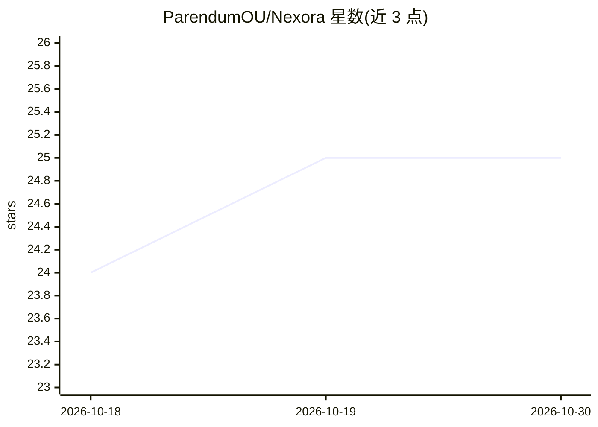

# ParendumOU/Nexora

⭐ 25 · Python · MIT · 推送 2026-10-09 · [GitHub](https://github.com/ParendumOU/Nexora) · [官网](https://nexora.parendum.com) · 组织维护

**自托管多租户 AI agent 编排平台，支持约 46 家 LLM 提供商**

MIT 许可的开源 AI-agent 编排平台核心：用户以人设+技能+工具定义 agent，agent 可实时对话、执行约 90 个内置工具、分解任务、生成有界子 agent，并通过 WebSocket/SSE 流式输出。LLM 接入层统一支持约 46 家提供商（含本地 Ollama），提供 pgvector 知识库/RAG、语义记忆、多租户认证与技能市场客户端。Docker Compose 部署，一键脚本安装；商业版 NexoraCloud 在此仓库之上叠加付费功能。

## 筛选速览

| 维度 | 判定 | 备注 |
|---|---|---|
| AI 角色 | `ai-ecosystem` | LLM/agent 周边工具 |
| 许可风险 | `permissive` | MIT |
| 部署形态 | `self-host` | docker 或自建部署 |
| 模型依赖 | local-ok | 支持本地模型 |
| 硬件要求 | — | 无带数字的原话,不猜 |
| 安装摩擦 | `low` | 无编译、无系统依赖或容器化 |
| 成熟度 | — | 结构信号不足 |

## 能力要点

- 约 46 家 LLM 提供商统一接口，可切换 Claude/GPT/Gemini/本地 Ollama
- 约 90 个内置工具与约 15 个技能，覆盖 Slack、Jira、Kubernetes、Playwright 等
- pgvector 知识库/RAG 与语义记忆、多模态图像输入
- 可视化的 React-Flow agent 构建器与市场客户端

## 适用场景

- 搭建触达 Slack、Jira、Kubernetes 等内部系统的 AI 运维助手
- 构建基于私有知识库的 RAG 研究 agent
- 让多 agent 分解目标、跨子 agent 执行自动化任务
- 作为闭源 agent 平台的自托管替代，自行掌控模型与数据

## 场景标签

`多智能体` `RAG` `模型网关` · 领域:Agent 开发

## 证据(README 行号)

> L29: Nexora is the **free, MIT-licensed OSS core** of an AI-agent orchestration platform. Users
> L40: - **🔌 No vendor lock-in.** ~46 LLM providers behind one interface; swap Claude ↔ GPT ↔ Gemini ↔ local Ollama withou

## 星数曲线

2026-10-18 24 → 2026-10-30 25（+1）

---
*卡片 v1 · prompt 1.4 · 生成 2026-10-27 · 置信度 high · 依据 README sha `cc10aaf87ac4` · [字段定义](../../DATASET.md)*
