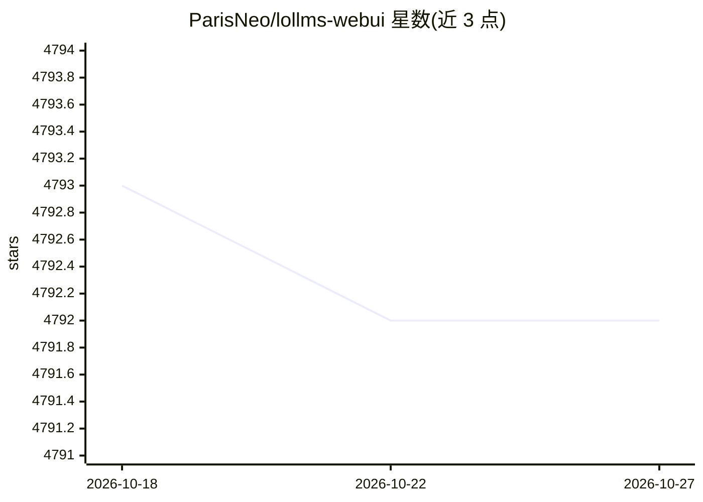

# ParisNeo/lollms-webui

⭐ 4,792 · Python · Apache-2.0 · 推送 2026-10-21 · [GitHub](https://github.com/ParisNeo/lollms-webui) · [官网](https://lollms.com) · 个人维护

**本地单用户多模型多模态 LLM Web 界面**

LoLLMs WebUI 是面向单用户的本地 LLM/多模态使用界面：通过选择 binding、模型与 personality 完成写作、代码调试、图像/视频/音乐生成等任务，内置 500+ 专家条件与讨论本地存储。支持 HuggingFace/GGUF/ExLlamaV2/Ollama/vllm/OpenAI/Anthropic 等多种后端，并按成本与速度做提示路由。安装提供脚本、手动 venv 与 Docker 三种方式；注意项目自述将被新版 lollms 项目完全替代，且无内置用户认证、主要面向本地使用。

## 筛选速览

| 维度 | 判定 | 备注 |
|---|---|---|
| AI 角色 | `ai-native` | 本体是模型或模型工具 |
| 许可风险 | `permissive` | Apache-2.0 |
| 部署形态 | `self-host` | docker 或自建部署 |
| 模型依赖 | local-ok | 支持本地模型 |
| 硬件要求 | — | 无带数字的原话,不猜 |
| 安装摩擦 | `low` | 无编译、无系统依赖或容器化 |
| 成熟度 | — | 结构信号不足 |

## 能力要点

- 多 binding 接入：HuggingFace/GGUF/ExLlamaV2/Ollama/vllm/OpenAI 等
- 支持文本、图像（stable diffusion/flux/dall-e 等）、视频、音乐生成
- Smart Routing 按成本与速度在模型间动态切换
- Docker、conda、venv 多种安装运行方式

## 适用场景

- 在本地统一界面使用多家 LLM 服务与本地模型
- 在写作、编码、数据分析等任务中切换不同模型与人格
- 控制多模型调用成本与响应速度

## 场景标签

`AI 助手` `图像生成` · 领域:对话与助手

## 证据(README 行号)

> L28: Welcome to LoLLMS WebUI (Lord of Large Language Multimodal Systems: One tool to rule them all), the hub for LLM (La
> L34: - Choose your preferred binding, model, and personality for your tasks
> L49: - Support for LLMs using multiple bindings:

## 星数曲线

2026-10-18 4,793 → 2026-10-27 4,792（-1）

---
*卡片 v1 · prompt 1.4 · 生成 2026-10-20 · 置信度 high · 依据 README sha `35e393dc3559` · [字段定义](../../DATASET.md)*
