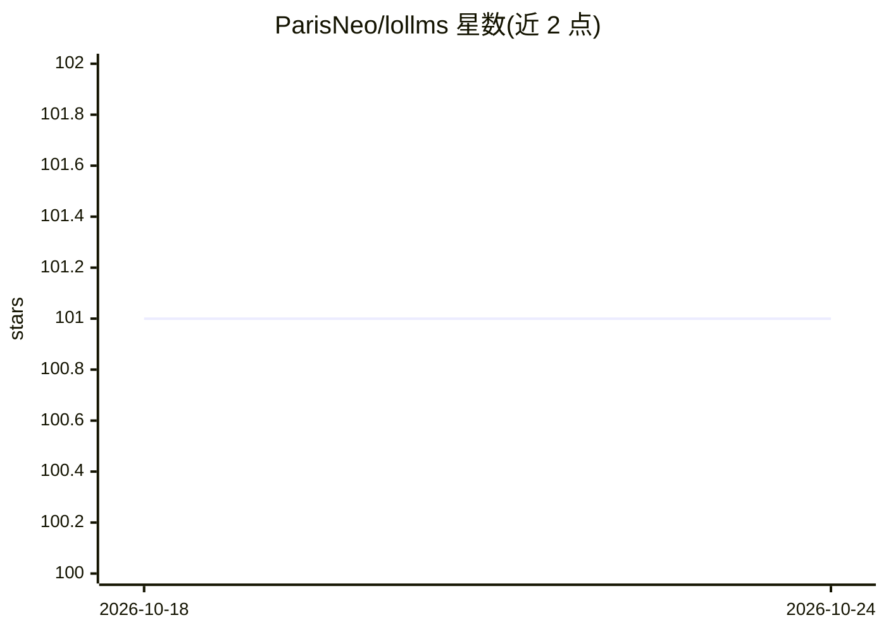

# ParisNeo/lollms

⭐ 102 · Vue · Apache-2.0 · 推送 2026-10-24 · [GitHub](https://github.com/ParisNeo/lollms) · [官网](https://lollms.com) · 个人维护

**多用户 Web 聊天应用：通过 lollms_client 接入多种 LLM 后端**

基于 FastAPI 后端与 Vue/Tailwind 前端的多用户聊天应用，经 lollms_client 库对接各类 LLM 后端，提供流式回复、多模态图像输入、基于 safe_store 的 RAG（按用户组织多个 DataStore 并可分享）、自定义 personality 系统、好友与私信、管理员面板（用户管理、LLM/TTI/TTS 绑定配置）。通过 git clone 加 run.sh 或 run_windows.bat 脚本安装，脚本自动创建虚拟环境并装依赖，浏览器访问 localhost:9642 使用，数据存 SQLite，Apache 2.0 许可。

## 筛选速览

| 维度 | 判定 | 备注 |
|---|---|---|
| AI 角色 | `ai-native` | 本体是模型或模型工具 |
| 许可风险 | `permissive` | Apache-2.0 |
| 部署形态 | `None` |  |
| 模型依赖 | — | README 未给出锁定关系 |
| 硬件要求 | — | 无带数字的原话,不猜 |
| 安装摩擦 | `low` | 无编译、无系统依赖或容器化 |
| 成熟度 | — | 结构信号不足 |

## 能力要点

- 经 lollms_client 接入多种 LLM 后端，流式回复与多模态图像输入
- 基于 safe_store 的 RAG：多 DataStore、多格式文件上传、按讨论开关与好友分享
- 多用户体系：token 认证、数据隔离、好友私信、管理员面板
- personality 系统支持自定义系统提示词、脚本与数据源

## 适用场景

- 部署一个多用户的 Web AI 聊天服务供团队或朋友使用
- 上传文档建 DataStore 后在对话中做 RAG 问答
- 通过管理员面板统一配置 LLM/TTI/TTS 后端绑定

## 场景标签

`聊天机器人` `RAG` `多模态` · 领域:对话与助手

## 证据(README 行号)

> L9: A multi-user FastAPI backend and responsive Vue/Tailwind CSS frontend application designed to provide a chat interfa
> L19: * **LLM Integration:** Uses `lollms-client` to interact with various LLM backends.

## 星数曲线

2026-10-18 101 → 2026-10-24 101（+0）

---
*卡片 v1 · prompt 1.4 · 生成 2026-10-23 · 置信度 high · 依据 README sha `f549e671434a` · [字段定义](../../DATASET.md)*
