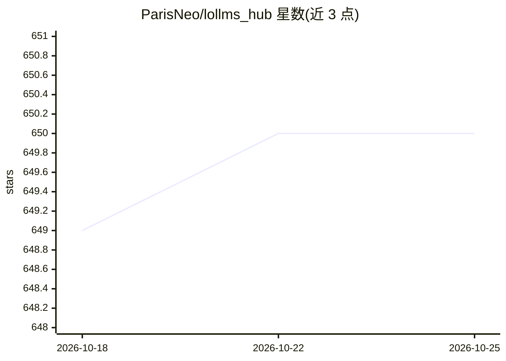

# ParisNeo/lollms_hub

⭐ 649 · Python · Apache-2.0 · 推送 2026-04-23 · [GitHub](https://github.com/ParisNeo/lollms_hub) · 个人维护

**多 AI 后端统一代理网关：安全、路由与负载均衡**

LoLLMs Hub 是聚合多种推理后端的 API 网关：将 Ollama、vLLM、llama.cpp 及 OpenAI 兼容 API 作为可替换计算节点统一纳管，提供密钥认证、用户管理、限流、HTTPS/SSL、负载均衡与使用统计。API 与 Ollama/OpenAI 兼容，支持主从 Hub 级联组网。还提供智能路由（优先级/随机/最少负载，含语义分类）、多模型并行 Ensemble、一键视觉路由与内置测试 Playground。安装方式为源码脚本（Windows 批处理 / macOS/Linux run.sh）或 Docker 构建。

## 筛选速览

| 维度 | 判定 | 备注 |
|---|---|---|
| AI 角色 | `ai-ecosystem` | LLM/agent 周边工具 |
| 许可风险 | `permissive` | Apache-2.0 |
| 部署形态 | `self-host` | docker 或自建部署 |
| 模型依赖 | local-ok | 支持本地模型 |
| 硬件要求 | — | 无带数字的原话,不猜 |
| 安装摩擦 | `low` | 无编译、无系统依赖或容器化 |
| 成熟度 | — | 结构信号不足 |

## 能力要点

- 统一纳管 Ollama/vLLM/llama.cpp/OpenAI 兼容后端并代理负载均衡
- 智能路由器（优先级/随机/最少负载，支持语义规则）与多模型 Ensemble
- 密钥安全、用户管理、限流、一键 HTTPS/SSL
- 主从 Hub 级联：Slaves 留在内网，仅 Master 公开暴露

## 适用场景

- 统一管理多台机器上的 Ollama 实例与模型
- 为文本模型快速挂接视觉模型组成视觉路由
- 对 AI API 按用户做密钥、限流与用量统计

## 场景标签

`模型网关` · 领域:Agent 开发

## 证据(README 行号)

> L7: LoLLMs Hub is designed for extreme scale and flexibility. It treats different inference engines as swappable compute
> L15: LoLLMs Hub is designed for extreme scale. Because its API is 100% compatible with Ollama and OpenAI, you can chain 

## 星数曲线

2026-10-18 649 → 2026-10-25 650（+1）

---
*卡片 v1 · prompt 1.4 · 生成 2026-10-21 · 置信度 high · 依据 README sha `a782654d5001` · [字段定义](../../DATASET.md)*
